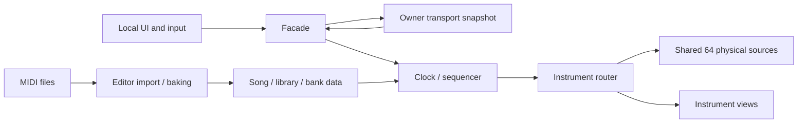

# 当前实现与源码地图

## 2026-11-05：海底全场景 3D 声音覆盖

海底场景64个共用音源的完整音量半径由5 m扩大至30 m，远端保持80 m，保留3D空间化；配置工具保留已有场景的空间参数。ClientSim已核对实际衰减曲线，主场景、历史钟楼、练习场景和分发Prefab保持，未做真实VRChat听音验收。详见[第27册](../UdonMidiPlayer/27-underwater-music-garden.md#全场景-3d-声音覆盖2026-11-05)。

## 2026-11-05：分发 Prefab 显式同步

推送边界补充：钟楼／海底场景文件、`.meta` 与 `Assets/Scenes/` 下同名专用资源目录仅在作者工程本地维护，不再由 Git 跟踪。下文两场景说明为本地实现事实，源码 checkout 不再携带其场景；通用播放器依赖继续完整保留。

按用户要求，两份分发 Prefab 从旧单钢琴配置增量同步主场景的七个活动旋律目标、独立鼓组、实时／文件映射、逐轨开关和八度／自动音域 UI、钢琴逐键命中与合并粒子、音源能量包络和当前规则哈希。分别默认三角／数码钢琴，保留原 13 首曲目及顺序、默认曲目、配置 GUID、原钢琴、歌曲对象与 64 个声音源；未 Apply 场景覆盖。主场景、海底、历史钟楼和练习场景未重存，美术场景专属表现未加入。保存后重新加载通过 `MidiBuildValidator.ValidateRoot`，Editor 隔离预览已检查主面板、乐器菜单和音轨映射；未构建、打包或做 VRChat 客户端验收。细节见[第08册](../UdonMidiPlayer/08-editor-and-prefab.md#分发-prefab-显式同步2026-11-05)。下方各功能“分发 Prefab 未更新”均为相应历史轮次记录。

## 2026-11-05：海底整体低台

海底演奏区按用户最新要求改为50 cm浅暖米色整体舞台，前方入口缓坡已删除，改为左右两侧各一组三等高踏步楼梯；乐器组合整体抬高，法阵从布局中心读取台面高度。首版18 cm的记录与最新50 cm验证分开保留，见[第27册](../UdonMidiPlayer/27-underwater-music-garden.md)。主场景、历史钟楼、练习场景及两份分发Prefab文件未变，未做世界构建或真实VRChat验收。

## 2026-11-05：文件音符奇偶双色

当前文件音符显示通道按奇偶最多两种色调，使用源MIDI主题下相差50.4°的邻近色调；单通道多音轨保留原音轨色槽回退，黑白键仍保留同色系深浅，最多两种色调、四种音符基础色。取代下文历史黄金角描述，实时演奏者主题不变。共用Runtime增量更新，无场景或分发Prefab重存；验证与实际Shader预览见[第06册](../UdonMidiPlayer/06-waterfall-and-keyboard.md#作者工程文件音符奇偶双色2026-11-05)，未做Play Mode或VRChat验收。

## 2026-11-04：rc.3 发布候选

本地当前 `VERSION=1.0.0-rc.3`，包含本页所记作者工程的黄金角文件通道配色和当前多乐器链。新增统一 [MIDI 曲库编辑器](../../Assets/UdonMidiPlayer/Editor/Import/MidiImportWindow.cs)、[源文件操作服务](../../Assets/UdonMidiPlayer/Editor/Import/MidiLibraryEditing.cs)及 [Unity 导入教程](../MIDI_IMPORT.md)。分类与曲目先编辑草稿，保存时编排源文件、源歌曲、曲库和场景应用；保持独立分发配置。下面 `21c0593 / rc.2` 为历史可获取基线，不代表 rc.3 缺少这些实现。rc.3 的发布产物与远端身份以第22册及该版本 `SEALED.json` 为准。

状态：静态源码核对入口。可获取实现基线：私仓 `21c0593` / `1.0.0-rc.2`；文档及贡献政策确认日期 2026-11-02。新提交可能改变实现，请先核对当前源码；本页不声称运行验收通过。

## 工程与交付边界

| 部分 | 路径 / 身份 | 边界 |
| --- | --- | --- |
| Unity 工程 | 仓库根；Unity 2022.3.22f1 / Worlds SDK 3.10.5 是记录基线 | 经 VCC / ALCOM 恢复 SDK；未声明支持所有更高版本 |
| 主场景 | [VRCDefaultWorldScene](../../Assets/Scenes/VRCDefaultWorldScene.unity) | 多乐器开发世界；不是两份分发 Prefab 能力的证明 |
| 当前海底美术场景 | [UnderwaterMusicGarden](../../Assets/Scenes/UnderwaterMusicGarden.unity) | 独立透明穹顶、大陆坡人工平台、海床遗迹与最多八件乐器；八音盒有琴时放琴上，无琴时使用独立桌。演奏显示地面法阵；七种鱼加水母以音符染色的点线／薄膜网格呈现，最多两色，覆盖上半球；外围生成后向外离场、不折返，运动与寿命跟随音乐时钟。当前海底使用唯一 Mixed Point Light、独立方向光照图与探针。钟楼保留原文件与 GUID 并标记 Historical；主场景和分发 Prefab 不替换，维护与验证见[第27册](../UdonMidiPlayer/27-underwater-music-garden.md) |
| 钟楼历史场景 | [ClockworkMaintenanceStreet](../../Assets/Scenes/ClockworkMaintenanceStreet.unity) | 2026-11-04 独立创建；沿用现有播放器，齿数约束传动与连接钟摆、客户端本地时钟、封闭结构及单一实时 Point Light 日月透光；回廊木构连接修正，另补无新增 Light 的屋顶间接光烘焙与探针；专属居中、落地、0.65 m 占地净距的固定组合扇形布局；美术精修轮次记录约 6.606 MB 源资源，包含材质、维修道具与单光源联动空气表现，后续光照资产及世界包增量见专题，未构建测量；Editor / Udon VM 检查按轮次记录，见[第二场景说明](../UdonMidiPlayer/25-clockwork-second-scene.md)，尚无真实客户端验收 |
| 默认三角钢琴的多乐器播放器 | [UdonMidiPlayer.prefab](../../Assets/UdonMidiPlayer/Prefabs/UdonMidiPlayer.prefab) | 2026-11-05 显式同步多乐器；独立分发配置及 13 首合规曲库 |
| 默认数码钢琴的多乐器播放器 | [UdonMidiPlayer_Upright.prefab](../../Assets/UdonMidiPlayer/Prefabs/UdonMidiPlayer_Upright.prefab) | 同次显式同步，保留默认外观；日常场景修改仍不自动同步 |
| 练习场景 | [MidiPractice.unity](../../Assets/UdonMidiPlayer/Samples/MidiPractice.unity) | 独立个人练习用途 |
| 可编辑美术 | `ArtSource/` | 保持在 Assets 外；对应导入模型与 `.meta` 不重复生成 |

私仓源码中为经审核的 13 首 MIDI、13 个曲目源资产和 757 个采样；作者工程完整曲库是另一内容集合。两者不能混写数字或自动同步。仓库仍为 private，尚无正式 v1.0 稳定发布或完整客户端性能验收。

## 模块与单向数据流

上表钟楼为历史版本 `Historical` / `Clockwork-2026-11-04`，其专用功能说明保留为历史事实；当前美术维护目标为海底场景。

图中的网络箭头表示状态提交 / 应用，不是逐音广播或远端调用本地 Command。Owner 可以转移；它与实例 Master 不同。本地视图和音频不能反向决定共享播放状态。

| 职责 | 当前源码入口 |
| --- | --- |
| 源曲目与配置 | [MidiSongAsset](../../Assets/UdonMidiPlayer/Editor/Assets/MidiSongAsset.cs)、[MidiLibraryAsset](../../Assets/UdonMidiPlayer/Editor/Assets/MidiLibraryAsset.cs)、[MidiPlayerConfigurationAsset](../../Assets/UdonMidiPlayer/Editor/Assets/MidiPlayerConfigurationAsset.cs) |
| 导入 / 数据烘焙 | [MidiImportService](../../Assets/UdonMidiPlayer/Editor/Import/MidiImportService.cs)、[MidiDataBaker](../../Assets/UdonMidiPlayer/Editor/Baking/MidiDataBaker.cs)、[MidiContentHash](../../Assets/UdonMidiPlayer/Editor/Baking/MidiContentHash.cs) |
| 小提琴自动奏法 | [ViolinArticulationBaker](../../Assets/UdonMidiPlayer/Editor/Baking/ViolinArticulationBaker.cs) 在 Editor 生成 MPC1 tag 6 的每音符 2 bit 计划；Runtime `ArticulationForNote` 统一发声、恢复及运弓查询；规则见 [弦乐专题](../UdonMidiPlayer/14-strings-preparation.md) |
| 操作、时间、音符 | [MidiPlayerFacade](../../Assets/UdonMidiPlayer/Runtime/Logic/MidiPlayerFacade.cs)、[MidiTransportClock](../../Assets/UdonMidiPlayer/Runtime/Logic/MidiTransportClock.cs)、[MidiSequencer](../../Assets/UdonMidiPlayer/Runtime/Logic/MidiSequencer.cs) |
| 同步 | [MidiNetworkTransport](../../Assets/UdonMidiPlayer/Runtime/Networking/MidiNetworkTransport.cs)；网络 backing Manual，其余本地组件 None |
| GM 规则的编辑源 | [MidiInstrumentRoutingBuilder](../../Assets/UdonMidiPlayer/Editor/Prefab/MidiInstrumentRoutingBuilder.cs) |
| 运行路由 | [MidiInstrumentRouter](../../Assets/UdonMidiPlayer/Runtime/Logic/MidiInstrumentRouter.cs)；不要误找 `Runtime/Audio/MidiInstrumentRouter.cs` |
| 共用声音池 | [PianoVoicePool](../../Assets/UdonMidiPlayer/Runtime/Audio/PianoVoicePool.cs)、[MidiEnsembleVoicePool](../../Assets/UdonMidiPlayer/Runtime/Audio/MidiEnsembleVoicePool.cs)、[StringsVoicePool](../../Assets/UdonMidiPlayer/Runtime/Audio/StringsVoicePool.cs)、[PercussionVoicePool](../../Assets/UdonMidiPlayer/Runtime/Audio/PercussionVoicePool.cs) |
| 安装 / 校验 | [MidiPlayerBuilder](../../Assets/UdonMidiPlayer/Editor/Prefab/MidiPlayerBuilder.cs)、[MidiStringsBuilder](../../Assets/UdonMidiPlayer/Editor/Prefab/MidiStringsBuilder.cs)、[MidiPercussionBuilder](../../Assets/UdonMidiPlayer/Editor/Prefab/MidiPercussionBuilder.cs)、[MidiBuildValidator](../../Assets/UdonMidiPlayer/Editor/Prefab/MidiBuildValidator.cs) |
| UI / 翻译 | [MidiPlayerUI](../../Assets/UdonMidiPlayer/Runtime/UI/MidiPlayerUI.cs)、[本地化说明](../../Assets/UdonMidiPlayer/Localization/README.md)、[UI 层级](../UdonMidiPlayer/15-ui-hierarchy.md) |
| 发布 / 许可 | [MidiReleasePolicy](../../Assets/UdonMidiPlayer/Editor/Prefab/MidiReleasePolicy.cs)、[发布工具](../../Tools/Release/release.mjs)、[许可范围](../../LICENSE.md) |

## 乐器身份与扩展点

| 旋律目标 ID | 当前用途 | 对应旧模型菜单索引 |
| ---: | --- | --- |
| 0 | 钢琴，共用 bank 的数码 / 三角外观 | 0 / 1 |
| 1 | 马林巴 | 2 |
| 2 | 小提琴 | 3 |
| 3 | 中提琴 | 4 |
| 4 | 大提琴 | 5 |
| 5 | 低音提琴 | 6 |
| 6 | 停用的旧弦乐组槽，保留身份和引用 | 7 |

鼓组默认处理文件通道索引 9，手动文件映射与可选轨名适配可覆盖，详见下文。六个活动旋律目标通过 11 个完整排序模板、GM 家族与例外回退；Program 0～127、目标 ID、菜单索引、通道不是同一编号。非空集合只选择已启用目标，不悄悄启用新音源，不把同一音符自动复制到多件乐器。细节见 [19 册](../UdonMidiPlayer/19-gm-program-fallback.md)。

代码仍有六目标数组、位掩码、128 位文件映射、目标事件及快照编码、语言表 / UI 固定集合。当前**没有自动发现新插件、通用外部乐器包协议或稳定的任意目标注册 API**。新增目标需要按实际代码设计迁移；不使用已停用 ID 或改长度就声称完成兼容。修改公共编码 / 快照时必须说明迁移与多人恢复影响。

钢琴 / 马林巴使用采样 bank；弦乐音头 / 循环体使用一对源；鼓组可能占末尾预留分区，合计仍在 64 个物理源中。每件新乐器申报其每逻辑音源成本。

## 基线之外的作者工程变化

作者工程已出现 `Assets/UdonMidiPlayer/Editor/Baking/AudioEnergyBaker.cs`、20 ms 能量数组和共享压缩的后续工作；这些不是上述 `21c0593` 私仓基线的已有文件或已发布能力。本次是文档工作，不随文档提交新的 Runtime / Editor 代码。

作者工程还将“音量平衡”改为默认开启，并取消日常 VRCSDK 构建回调中完整播放器校验的硬阻断；这些也尚未进入 `21c0593`。该基线的 `MidiBuildValidator.OnBuildRequested` 仍调用完整校验并在异常时返回 false。维护约定里的新目标不能被当作旧基线已经具备的行为；需要同步实现时应单独开展代码任务，本文不替它完成迁移。

若自己的分支已有这条能量链，应核对对应 Builder、bank 哈希及 backing 数组，沿用已存在的链路；若没有，记录基线差异并请维护者明确接入版本，不从这段文字虚构 API 或复制一个空类。后续同步实现时须一起更新本页与文档地图。

## 作者工程：文件音轨映射（2026-11-03）

根据最新要求移除文件通道映射，新增共享 `fileTrackMap`，来源音轨覆盖优先于原始 Program 及自动回退，文件通道 10 的默认鼓路由现已允许覆盖。“乐器映射”仅提供原音色 / 原始音轨两个页签；完整快照和规则哈希同步扩展。主场景增量接线，独立练习和分发 Prefab 不自动更新。详细规则及《拼凑的断音》原始数据核对见 [19 册](../UdonMidiPlayer/19-gm-program-fallback.md#播放器内音轨映射2026-11-03)。这不是 `21c0593` 基线或已发布版本的能力。

## 作者工程：可选轨名适配（2026-11-04）

“按原始音轨”页增加默认关闭的 `autoTrackRouting` 复选框，进入完整公共快照、接收、回滚与 Owner 交接。原 MIDI / 歌曲身份与 Program 元数据保留；按轨名缓存代表音色，旋律沿用已选目标和提琴音域，鼓轨按用户确认的近似规则送到现有鼓组。手动音轨 → 手动音色 → 可选轨名 → GM 默认；取消文件通道 10 鼓组独占。音频、鼓件动作、瀑布与琴键共用路由结果，鼓索引重建沿用分帧加载预算；硬件 MIDI 的个人设置独立。UAAK 全 425 首、5,492 条有音符轨与 1,928,062 个音符已解析，详情及验证边界见 [19 册](../UdonMidiPlayer/19-gm-program-fallback.md#可选轨名自动适配2026-11-04)。

## 作者工程：逐音轨开关（2026-11-04）

播放文件“乐器映射 → 按原始音轨”增加默认开启的逐行复选框。关闭保留目标，旋律及鼓组共用静音门控；不改乐器勾选集合或硬件输入。状态嵌入原共享 `fileTrackMap`，规则升级为 `selected-gm-v11-track-switches`，主场景增量接线及 catalogHash 同步更新。切歌按原始轨号保留，重置音轨页恢复全部开启。详见 [逐音轨开关](../UdonMidiPlayer/19-gm-program-fallback.md#逐音轨开关2026-11-04)。

## 作者工程：音轨八度与自动音域（2026-11-04）

文件按原始音轨页增加逐轨八度 −10～+10 与默认关闭的整页自动音域，播放／暂停／停止均可修改。按实际映射乐器的原始实录根音范围折回越界音，鼓组保留原鼓键，实时输入独立；声音与全部文件表现共用 `PitchForNote`。扩展编码复用共享 `fileTrackMap`，旧六字符记录继续可读，当前规则 `selected-gm-v13-track-pitch` 保留并行鼓组选择位。范围来自原 bank 清单并排除派生音，详见 [音高规则](../UdonMidiPlayer/19-gm-program-fallback.md#音轨八度与自动音域2026-11-04)。

## 作者工程：玩家实时配色（2026-11-04）

硬件 MIDI、PC 键盘及 VR 弹奏统一使用演奏者原始 Display Name 的稳定 FNV-1a 哈希生成主色调，Owner 提供远端演奏者身份，个人练习使用 LocalPlayer；琴键、瀑布、粒子、弦乐和鼓组沿用同色系，文件播放／暂停恢复源 MIDI 配色。复用现有引用与缓存，无新增网络字段或场景接线。UdonSharp 编译及 21 项 Editor preview 代理检查通过，未做真实客户端／多客户端验收，详见[实时配色](../UdonMidiPlayer/06-waterfall-and-keyboard.md#作者工程玩家实时配色2026-11-04)。

## 验证状态

钟楼第二场景 2026-11-04 演奏区布局预览已保存：既有乐器组合中心向入口平移 2.3 m，缩小并移动原地毯、挪近两张原工作凳，控制台同步避让合奏范围，无新增摆件。512 配置占地／障碍物净距通过 Editor 静态检查；按用户最新要求，先展示布局，光线调整与重新烘焙尚未执行，等待用户审阅。截图沿用既有照明，详见[布局预览](../UdonMidiPlayer/25-clockwork-second-scene.md#2026-11-04-演奏区布局预览烘焙等待用户审阅)。

作者工程 2026-11-04 钢琴特效升级：主场景及钟楼第二场景两种钢琴保留 GPU 水晶瀑布，增加单网格逐音高冲击、文件／实时力度变化和局部落键提亮；尘粒／六类符号合并为两个系统、总上限192并移除世界碰撞，活动槽回收跳过空槽。22项 Editor 代理／渲染 UV 检查和10项 backing Udon VM 检查通过，钟楼仍仅一个 Light、共用64个声音源。未做客户端性能采样或真实 VRChat 验收；练习／分发 Prefab 不自动迁移，详见[钢琴命中表现](../UdonMidiPlayer/06-waterfall-and-keyboard.md#作者工程钢琴逐键命中与低负载粒子2026-11-04)。

作者工程 2026-11-04 增加马林巴／八音盒离线线性响度校准（请求 +6／+15 dB，每文件按 −1.5 dBFS 解码过采样峰值限制），保留力度曲线；共用输出追加保守的干声合奏峰值余量。准备工具、Apply Tone Changes 的八音盒更新和 bank/catalog/backing 一起维护，见[乐器响度校准](../UdonMidiPlayer/13-instruments.md#乐器响度校准与合奏余量2026-11-04)。这不属于旧 rc.2 基线或真实客户端听音验收。

主场景顶部乐器列表已追加默认开启的鼓组开关（2026-11-04），菜单索引9不占用旋律模型槽；共享 `enabledInstrumentMask` 的 bit8 控制文件和实时鼓声，有效位447，旋律位仍191。仅切换鼓组保留旋律声部与播放进度，本地显示偏好仍独立。实际 backing Udon／原生 Toggle 验证见 `Logs/DrumInstrumentToggle-Validation.json`；未做真实 VRChat 多客户端验收，分发 Prefab 与练习场景不自动更新。

- rc.2 有源码 / 许可 / 哈希 / 引用的静态记录和远端提交核对，不等于所有音乐与模型已经听音或运行通过。
- Windows 性能优化有代码和边界说明，尚无其性能实测收益承诺。
- 新增乐器的正式收录采用最新[贡献政策](../Contributing/README.md)，必须有该贡献版本的 PC VRChat 单客户端证据；旧项目未验收不是允许新贡献省略此项的理由。
- 不把新准入政策说成现有资产已全部满足，也不据文档任务自动批量改造现有工程。

## 作者工程：八音盒（2026-11-04）

主场景追加八音盒，目标 **7**、模型索引 **8**；旧目标6／模型7继续停用。七个活动目标用7位有效掩码 `191`（跳过bit6），12组完整排序，GM Program 10优先八音盒，其余原排序在马林巴之后插入八音盒。`MidiMusicBoxBuilder` 增量导入／接线；共享64物理源，每音1源。88个实体梳齿 A0–C8，声音保留MIDI 0–127；低音和上边缘为派生变调，非新增实录。专用旋转针带和拨片阻尼振动复用 `PianoKeyboardView` 的可选机械字段，继承马林巴瀑布、曲目配色和轻粒子。源采样为rbnuser的CC0录音，详见[八音盒准备](../UdonMidiPlayer/24-music-box.md)。

实时起音追加kind10（旧kind9保留停用），快照目标+1允许8，占20～23位；文件映射允许数字8而不启用7。规则哈希更新，旧客户端不得混用。主场景已接线；PC VRChat、双客户端、物理MIDI／VR及移动端未验收；不改练习场景和分发Prefab。

补充：同日文件鼓组目标使用v10，逐音轨开关使用v11，鼓组列表选择使用v12；当前音轨八度与自动音域合并为`selected-gm-v13-track-pitch`。文件picker保留八音盒Target8及鼓组Target9；八音盒目标／事件／快照编码不变。

## 作者工程：文件通道黄金角配色（2026-11-04）

文件播放／暂停以源 MIDI 哈希主色为起点，原始通道索引每步旋转黄金角约137.507764°；瀑布、琴键、命中／粒子、弦乐、鼓组和钟楼连线统一跟随，保留黑白键深浅。实时演奏沿用玩家名称主色，无新增网络字段或场景接线。UdonSharp编译与87项隔离Editor代理检查通过，未做真实客户端验收，详见[通道配色](../UdonMidiPlayer/06-waterfall-and-keyboard.md#作者工程文件通道黄金角配色2026-11-04)。

## 作者工程：海底场景与单通道多音轨配色（2026-11-05）

Testify 钢琴谱两条音轨共用源 MIDI 通道0，新增仅表现的音轨色槽回退，使两轨各自保留黑白键两档、共四色；多通道歌曲沿用原通道色。海底法阵固定通道0明色，鱼群最多两种明色并覆盖上半球，外围鱼只向外离场。琴键与GPU Note新增力度峰值、25 ms起亮和缓慢衰减的Shader包络；海底场景接入专属按键材质、大陆坡平台、高质量单点光源软阴影和独立光照烘焙。维护入口、证据与验收边界见[第27册](../UdonMidiPlayer/27-underwater-music-garden.md#大陆坡四色与力度发光调整2026-11-05)。未构建或做真实VRChat验收。

## 作者工程：十二等分中空法阵（2026-11-05）

海底法阵依照新 ImageGen 环形参考重描，十二份同一扇区的几何保证旋转对称；中心留白，依次展开内环、交织弧带、外围骨架、符纹、刻度封环。完整展开2.8秒，短音保留完整展开时间，连续音延长停留且不重启，暂停冻结。原法阵网格GUID、固定通道0配色、琴上八音盒共用及单Point Light约束保留。维护入口与证据见[第27册](../UdonMidiPlayer/27-underwater-music-garden.md#十二等分中空法阵与分阶段展开2026-11-05)。
