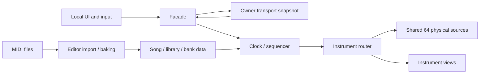

# 当前实现与源码地图

状态：静态源码核对入口。可获取实现基线：私仓 `21c0593` / `1.0.0-rc.2`；文档及贡献政策确认日期 2026-11-02。新提交可能改变实现，请先核对当前源码；本页不声称运行验收通过。

## 工程与交付边界

| 部分 | 路径 / 身份 | 边界 |
| --- | --- | --- |
| Unity 工程 | 仓库根；Unity 2022.3.22f1 / Worlds SDK 3.10.5 是记录基线 | 经 VCC / ALCOM 恢复 SDK；未声明支持所有更高版本 |
| 主场景 | [VRCDefaultWorldScene](../../Assets/Scenes/VRCDefaultWorldScene.unity) | 多乐器开发世界；不是两份分发 Prefab 能力的证明 |
| 三角钢琴 | [UdonMidiPlayer.prefab](../../Assets/UdonMidiPlayer/Prefabs/UdonMidiPlayer.prefab) | 独立分发配置及合规曲库 |
| 立式 / 数码钢琴 | [UdonMidiPlayer_Upright.prefab](../../Assets/UdonMidiPlayer/Prefabs/UdonMidiPlayer_Upright.prefab) | 独立模型配置，不自动继承主场景扩展 |
| 练习场景 | [MidiPractice.unity](../../Assets/UdonMidiPlayer/Samples/MidiPractice.unity) | 独立个人练习用途 |
| 可编辑美术 | `ArtSource/` | 保持在 Assets 外；对应导入模型与 `.meta` 不重复生成 |

私仓源码中为经审核的 13 首 MIDI、13 个曲目源资产和 757 个采样；作者工程完整曲库是另一内容集合。两者不能混写数字或自动同步。仓库仍为 private，尚无正式 v1.0 稳定发布或完整客户端性能验收。

## 模块与单向数据流

图中的网络箭头表示状态提交 / 应用，不是逐音广播或远端调用本地 Command。Owner 可以转移；它与实例 Master 不同。本地视图和音频不能反向决定共享播放状态。

| 职责 | 当前源码入口 |
| --- | --- |
| 源曲目与配置 | [MidiSongAsset](../../Assets/UdonMidiPlayer/Editor/Assets/MidiSongAsset.cs)、[MidiLibraryAsset](../../Assets/UdonMidiPlayer/Editor/Assets/MidiLibraryAsset.cs)、[MidiPlayerConfigurationAsset](../../Assets/UdonMidiPlayer/Editor/Assets/MidiPlayerConfigurationAsset.cs) |
| 导入 / 数据烘焙 | [MidiImportService](../../Assets/UdonMidiPlayer/Editor/Import/MidiImportService.cs)、[MidiDataBaker](../../Assets/UdonMidiPlayer/Editor/Baking/MidiDataBaker.cs)、[MidiContentHash](../../Assets/UdonMidiPlayer/Editor/Baking/MidiContentHash.cs) |
| 操作、时间、音符 | [MidiPlayerFacade](../../Assets/UdonMidiPlayer/Runtime/Logic/MidiPlayerFacade.cs)、[MidiTransportClock](../../Assets/UdonMidiPlayer/Runtime/Logic/MidiTransportClock.cs)、[MidiSequencer](../../Assets/UdonMidiPlayer/Runtime/Logic/MidiSequencer.cs) |
| 同步 | [MidiNetworkTransport](../../Assets/UdonMidiPlayer/Runtime/Networking/MidiNetworkTransport.cs)；网络 backing Manual，其余本地组件 None |
| GM 规则的编辑源 | [MidiInstrumentRoutingBuilder](../../Assets/UdonMidiPlayer/Editor/Prefab/MidiInstrumentRoutingBuilder.cs) |
| 运行路由 | [MidiInstrumentRouter](../../Assets/UdonMidiPlayer/Runtime/Logic/MidiInstrumentRouter.cs)；不要误找 `Runtime/Audio/MidiInstrumentRouter.cs` |
| 共用声音池 | [PianoVoicePool](../../Assets/UdonMidiPlayer/Runtime/Audio/PianoVoicePool.cs)、[MidiEnsembleVoicePool](../../Assets/UdonMidiPlayer/Runtime/Audio/MidiEnsembleVoicePool.cs)、[StringsVoicePool](../../Assets/UdonMidiPlayer/Runtime/Audio/StringsVoicePool.cs)、[PercussionVoicePool](../../Assets/UdonMidiPlayer/Runtime/Audio/PercussionVoicePool.cs) |
| 安装 / 校验 | [MidiPlayerBuilder](../../Assets/UdonMidiPlayer/Editor/Prefab/MidiPlayerBuilder.cs)、[MidiStringsBuilder](../../Assets/UdonMidiPlayer/Editor/Prefab/MidiStringsBuilder.cs)、[MidiPercussionBuilder](../../Assets/UdonMidiPlayer/Editor/Prefab/MidiPercussionBuilder.cs)、[MidiBuildValidator](../../Assets/UdonMidiPlayer/Editor/Prefab/MidiBuildValidator.cs) |
| UI / 翻译 | [MidiPlayerUI](../../Assets/UdonMidiPlayer/Runtime/UI/MidiPlayerUI.cs)、[本地化说明](../../Assets/UdonMidiPlayer/Localization/README.md)、[UI 层级](../UdonMidiPlayer/15-ui-hierarchy.md) |
| 发布 / 许可 | [MidiReleasePolicy](../../Assets/UdonMidiPlayer/Editor/Prefab/MidiReleasePolicy.cs)、[发布工具](../../Tools/Release/release.mjs)、[许可范围](../../LICENSE.md) |

## 乐器身份与扩展点

| 旋律目标 ID | 当前用途 | 对应旧模型菜单索引 |
| ---: | --- | --- |
| 0 | 钢琴，共用 bank 的数码 / 三角外观 | 0 / 1 |
| 1 | 马林巴 | 2 |
| 2 | 小提琴 | 3 |
| 3 | 中提琴 | 4 |
| 4 | 大提琴 | 5 |
| 5 | 低音提琴 | 6 |
| 6 | 停用的旧弦乐组槽，保留身份和引用 | 7 |

鼓组独立处理通道索引 9。六个活动旋律目标通过 11 个完整排序模板、GM 家族与例外回退；Program 0～127、目标 ID、菜单索引、通道不是同一编号。非空集合只选择已启用目标，不悄悄启用新音源，不把同一音符自动复制到多件乐器。细节见 [19 册](../UdonMidiPlayer/19-gm-program-fallback.md)。

代码仍有六目标数组、位掩码、128 位文件映射、目标事件及快照编码、语言表 / UI 固定集合。当前**没有自动发现新插件、通用外部乐器包协议或稳定的任意目标注册 API**。新增目标需要按实际代码设计迁移；不使用已停用 ID 或改长度就声称完成兼容。修改公共编码 / 快照时必须说明迁移与多人恢复影响。

钢琴 / 马林巴使用采样 bank；弦乐音头 / 循环体使用一对源；鼓组可能占末尾预留分区，合计仍在 64 个物理源中。每件新乐器申报其每逻辑音源成本。

## 基线之外的作者工程变化

作者工程已出现 `Assets/UdonMidiPlayer/Editor/Baking/AudioEnergyBaker.cs`、20 ms 能量数组和共享压缩的后续工作；这些不是上述 `21c0593` 私仓基线的已有文件或已发布能力。本次是文档工作，不随文档提交新的 Runtime / Editor 代码。

作者工程还将“音量平衡”改为默认开启，并取消日常 VRCSDK 构建回调中完整播放器校验的硬阻断；这些也尚未进入 `21c0593`。该基线的 `MidiBuildValidator.OnBuildRequested` 仍调用完整校验并在异常时返回 false。维护约定里的新目标不能被当作旧基线已经具备的行为；需要同步实现时应单独开展代码任务，本文不替它完成迁移。

若自己的分支已有这条能量链，应核对对应 Builder、bank 哈希及 backing 数组，沿用已存在的链路；若没有，记录基线差异并请维护者明确接入版本，不从这段文字虚构 API 或复制一个空类。后续同步实现时须一起更新本页与文档地图。

## 验证状态

- rc.2 有源码 / 许可 / 哈希 / 引用的静态记录和远端提交核对，不等于所有音乐与模型已经听音或运行通过。
- Windows 性能优化有代码和边界说明，尚无其性能实测收益承诺。
- 新增乐器的正式收录采用最新[贡献政策](../Contributing/README.md)，必须有该贡献版本的 PC VRChat 单客户端证据；旧项目未验收不是允许新贡献省略此项的理由。
- 不把新准入政策说成现有资产已全部满足，也不据文档任务自动批量改造现有工程。
