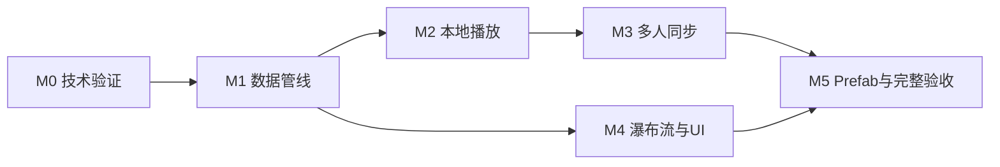

# 实施里程碑与交付清单

实施以 [统一约定](CONTRACTS.md) 为基线，先验证 SDK 关键能力，再冻结数据和运行路径。完整模块关系见 [架构](01-architecture.md)，每一阶段的测试内容引用 [验收计划](09-performance-and-validation.md)。

## 1. 依赖与并行关系

M0 内已包含简化双客户端试验，避免把网络风险推迟到 M3。M1 后视觉可以并行；音源资源制作与接口实现也可并行。完整功能仍需等待数据、逻辑、网络、声音和表现收口。

## 2. M0 技术验证

预计 1～2 个工作日。只用一首可控短曲和少量代表采样，验证：

- 具体 UdonSharp Behaviour 引用、基础一维数组、AudioClip[] 和烘焙数据可通过编译并在客户端读取。
- 显式 `MusicMidiPlayer.*` 命名空间、Runtime/Editor asmdef、Runtime 的 U# Assembly Definition 注册及跨模块类型引用在当前 SDK 中可编译；Editor 类型与解析依赖不进入运行程序集。
- PlayScheduled/dspTime、timeSamples、pitch、Stop 对已预约声音的取消、释放增益与重新定位的实际行为。
- 至少一组和弦、同音重叠、暂停/恢复和当前进度长音恢复。
- 两客户端本地操作、SetOwner/IsOwner/OnOwnershipTransferred、Manual Sync 快照和晚加入的基本流程。
- NetworkCallable、网络调用上下文和发送者识别可以阻断非预期远端提交。
- 当前世界 real voices 和采样导入配置能满足基本复音，不只检查组件数。

输出最小可运行验证场景、实际 API/行为记录和精度初测。若 DSP 预约不可用，先确认逐帧触发能否满足目标并更新音频方案；不能静默降级后仍沿用原精度承诺。

M0 通过后冻结数据 schemaVersion=1、最小组件依赖、音源与时钟调用路径；必要修正同步到所有分册。

## 3. M1 数据与导入

预计 2～3 个工作日。

- [ ] 实现显式批量导入窗口与固定版本的 Editor 解析适配器。
- [ ] 完成 Type 0/1、PPQ、tempo map、轨道/通道选择和诊断。
- [ ] 正确处理 velocity=0、FIFO 音符配对、CC64 和异常尾部。
- [ ] 生成音符数组、稳定事件流、1000 ms CSR 检查点与统计。
- [ ] 实现曲目/曲库源资产、songId 稳定映射与增量重导入。
- [ ] 打通从 Editor 源资产到场景运行数据的最小烘焙链。

通过条件：D01～D07 的预期均明确且可重复；重导入保留 GUID/引用；运行数据合法且能够被 Sequencer 消费。此时不能把“导入成功”当成播放功能完成。

## 4. M2 本地播放与钢琴音频

预计 3～4 个工作日。

- [ ] 完成 Facade 的四个公共命令及幂等/无效操作处理。
- [ ] 实现 Clock 与本地 DSP 映射、事件推进与前视预约分离。
- [ ] 实现 64 voice 固定池、音源区域选择、力度、释放与回收。
- [ ] 实现暂停冻结、恢复定位、停止/切曲清理和 applyGeneration 取消。
- [ ] 实现检查点恢复与 Release 尾音候选查询。
- [ ] 完成主动 Stop 与带安全尾垫的自然曲终。
- [ ] 使用代表样本验证音源覆盖、自然衰减、削峰和内存。

通过条件：L01～L04、A01 无挂音或旧曲污染；声音恢复不集中补播历史起音；音频回收不修改逻辑。正式可分发音源可以此时替换原型采样，但在 M5 前必须完成验收。

## 5. M3 多人同步

预计 2～3 个工作日。

- [ ] 实现唯一 Manual Sync Transport、完整快照和 OnPreSerialization 自洽采样。
- [ ] 本地响应、ownership 提交、一个可替换待提交意图、失败撤销。
- [ ] ApplyRemoteSnapshot 无提交副作用，处理就绪前缓存与重复快照。
- [ ] 实现晚加入补发、请求节流、周期校准和可信 Owner 心跳。
- [ ] 实现 Playing 下失活随机接管、正常 ownership 交接和公共终态单次发布。
- [ ] 覆盖并发控制、序列化失败、延迟旧回调和跨 Owner 序号边界。

通过条件：多人矩阵不出现永久分叉、反复抢权或接收回环。逻辑时间偏差与实际声音起音分别收集证据，公开仍存在的首播延迟和音频设备延迟边界。

## 6. M4 瀑布流、键盘与 UI

预计 2～3 个工作日，可在 M1 后并行。

- [ ] 完成 52 白键/36 黑键布局与 A0～C8 映射。
- [ ] 绝对时间音符条、长音裁剪、3 秒前视及固定 512 条可见池。
- [ ] 使用 KeyUp 语义高亮，踏板音不让按键继续按下。
- [ ] 完成暂停冻结、停止清空、重建恢复与对象池降级。
- [ ] 完成曲名/状态/只读进度、曲目列表、控制及本地音量/静音。
- [ ] 完成世界尺度下桌面和 VR 指针的交互可读性。

通过条件：V01～V02 及 UI 验收通过；表现关闭或溢出时播放进度和声音逻辑仍正常；无逐音符脚本和稳态 Instantiate/Destroy。

## 7. M5 Prefab 与交付收口

预计约 2 个工作日，复杂世界集成另留缓冲。

- [ ] 配置工具自动烘焙、生成 UI、接线并检查缺项。
- [ ] 接入当前 SDK 的构建前校验，识别脏数据与编译错误。
- [ ] 完成默认 Prefab、单实例示例、双实例隔离示例/验证。
- [ ] 完成可分发钢琴采样、材质、网格、字体、示例曲与来源说明。
- [ ] 完成新场景零代码接入、重导入和多人端到端验收。
- [ ] 在独立干净世界工程导入分发成品，验证命名空间/程序集、同短类名组件共存、GUID 保留和升级引用。
- [ ] 记录最终声音池/视觉池预算、同步测量与已知边界。
- [ ] 更新接入说明、变更记录和本方案中的已验证状态。

通过条件：六项 P0 全部满足；任何缺失采样、缺引用、未烘焙或未编译都不能标记交付完成。

## 8. 最终交付物

| 类别 | 成品要求 |
| --- | --- |
| Editor | 批量导入器、源资产、解析依赖、诊断、配置与烘焙工具 |
| Runtime | 数据载体、控制/Clock/Sequencer、Manual Sync Transport、音频、View 与 UI |
| 命名与程序集 | 全部自有类型位于 MusicMidiPlayer.*；Runtime/Editor asmdef 与 U# 程序集注册资产齐全 |
| 资源 | 音源、共享材质、键盘与音符几何、字体和固定池 |
| Prefab | 所有必要引用与回调已接好，可配置曲库与音源 |
| 示例 | 最小可运行场景、可分发示例 MIDI、功能测试曲 |
| 文档 | 接入流程、格式边界、参数说明、故障定位、来源与许可清单 |
| 验证记录 | Udon 编译、单机、多人、性能、音频、重导入与新场景接入证据 |

## 9. 工期假设与未决项

熟悉 UdonSharp 的单人开发，沿用当前工程且已经有可用采样，估计约 12～18 个工作日，并另留约 20% 集成缓冲。估时在 M0 完成后重估；多人并行可以缩短部分阶段，但不能跳过接口和端到端验证。

实施前需要落实的资源项为正式采样及其分发许可、默认音色与音量、目标 PC 设备/世界负载、首批曲目规模。它们不阻断当前设计落盘，但会影响 M2/M5 的资源成品和最终性能参数。

当前仅完成本套设计文件；上述实施清单未据此勾选。后续优先从 M0 开始，不先堆完整 UI 或批量创建大量资源后再验证音频与同步。
