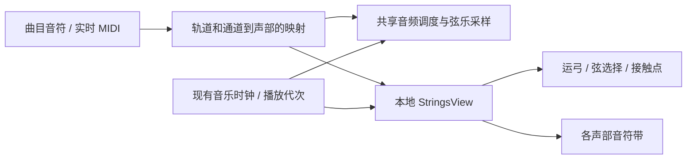

# 弦乐组接入准备

> 2026-10-31 已保存主场景的五个弦乐选项及相应引用。本文下部的调研基线保留作研究依据；现状以“已落地的接入”和验证记录为准。后续追加入口见 [新乐器追加规范草案](18-adding-instruments.md)，Program 候选映射见 [fallback 草案](19-gm-program-fallback.md)。

日期：2026-10-31 开始施工，2026-11-01 取消钢琴窗 / 落琴音符，改为琴弦发光与粒子。状态：音源、模型、主场景接线、Unity/UdonSharp 编译、backing Udon 发声、下拉交互及当前发光 / 粒子检查已通过。真实 VRChat、双客户端及听感尚未验收。

用户已选择：**无人演奏的乐器陈列，琴弓和琴弦随音乐运动**。

## 2026-11-01 后续变更

最新追加：四把提琴分别提供自动 / 长弓 / 跳弓 / 拨弦。手动选择覆盖原 Program 奏法推断，默认自动保留原行为；声音、文件定位恢复、实时输入及运弓读取对应目标的选择。奏法入口已移至各自乐器行右侧，未勾选时禁用，不再堆放于底部；四项选择随公共完整快照、晚加入、所有权交接和回滚恢复。切换只替换该提琴的活动 / 预约声源，保留音符年龄和释放状态，以及其他乐器的源与起点；暂停中选择不发声、不改进度。旧五声部槽继续停用。

`Tools/validate_independent_strings.cs.txt` 在主场景实际 backing Udon 中的 43 项检查通过，报告为 `Logs/independent-strings-playmode.json`。覆盖四件乐器 × 四种选项、原生按钮、独立声音与文件恢复、保持其他乐器、暂停静音、接收快照及无效编码回滚；四把琴均验证与钢琴哈希调色板完全相等，弦光、光粒和漂浮符号都实际发射。渲染见 `Captures/IndependentStrings/{SoloViolin,Viola,Cello,Contrabass}.png`，菜单为 `ArticulationMenu.png`；四个入口的 GraphicRaycaster 命中分别为 Entry / EntryViola / EntryCello / EntryContrabass。Unity C# / UdonSharp 编译及 Console 检查无新增错误。此为 Editor / ClientSim 验证，未做真实 VRChat、双客户端或听感验收，未构建 / 发布。

主场景已取消弦乐组入口和舞台显示，只保留小提琴、中提琴、大提琴、低音提琴；旧组的对象/音源引用作为停用槽保留。复选组合的自动回退改为音域重叠中点分配，支持六种两两组合及三/四把组合。播放器内可对当前曲目的原 Program 手动选取目标，未启用的目标自动打开。详见 [GM 音色分组与回退](19-gm-program-fallback.md)。下方五声部组的接入和验证记录为此前实现历史，不再表示当前可选菜单。

同日补齐小提琴表现并复用到共用 `StringsView`：与钢琴按同一 `sourceHash` 生成完全一致的亮 / 暗调色板，琴弦、接触点和光粒按音高选择同色系深浅；音乐符号使用钢琴相同的整曲亮色。新增 `StringSymbols0..3`，复用钢琴的符号网格、图集、材质和粒子生命周期 / 透明度 / 上浮曲线，尺寸和运动范围缩小到琴弦附近；符号仅在新起音时低频发射，定位不补播旧符号。光粒改为逐次发射颜色，不再用材质叠乘整曲颜色。琴体固定及运弓保持。

每根弦光粒上限 12、符号上限 4，单件总上限 64（48 光粒＋16 符号），停用五声部槽为 320。`MidiStringsBuilder.UpdatePresentation(player)` 已增量更新主场景的五个既有 View 与 proxy / backing 引用，不修改曲库、音源或分发 Prefab，也不重新启用旧组。钢琴 Builder 的两类配置供弦乐复用，钢琴参数保持原值。

本次 Unity C# / UdonSharp 编译通过。`Tools/validate_strings_presentation.cs.txt` 在主场景 Play Mode 直接驱动实际 backing Udon，24 项检查通过，记录为 `Logs/strings-piano-presentation-playmode.json`：双层发射、亮暗配色与钢琴相等、源哈希变化 / 大小写 / 默认主题、暂停冻结、定位清旧符号、路由过滤、密集起音预算、琴体固定、实时路由输入和停止清理。`Captures/Strings-PianoAligned-PlayMode.png` 为临时相机隔离渲染的小提琴实际 Udon 状态，避免 ClientSim 菜单遮挡；未进行真实 VRChat / 双客户端验收，未构建或发布。

## 已落地的接入（此前五声部方案记录）

- 主场景原有三个选项后新增小提琴、中提琴、大提琴、低音提琴、弦乐组；乐器与长弓/跳弓/拨弦均使用下拉选择，并随 Owner 快照同步。乐器条收起时显示当前选择，展开为竖向列表；选择或点击外部关闭。奏法为单独的子下拉，选择后自动收起。
- 正式音源在 `Assets/UdonMidiPlayer/Audio/Strings/`：193 个实录根音/奏法组合，增加 42 个高音辅助区域，共 235 个区域、314 个音频文件。五套 bank 分别为独奏小提琴 49、小提琴组 39、中提琴组 43、大提琴组 48、低音提琴 56 个区域。辅助区域是原录音派生，不计作额外实录。
- 采用单个较强实录力度层，48 kHz 单声道 PCM16，源 WAV 合计 46,303,172 bytes（约 44.16 MiB）；未逐音归一化。这个数不是构建下载体积或客户端内存。完整来源、派生关系和 SHA256 在 `BANK-MAPPING.json`，CC0 许可与作者说明随音源保存。
- 79 个长弓区域拆为自然音头和无缝循环主体，用 DSP 预约衔接；每个逻辑音符使用既有声源池中的一对 AudioSource。总物理源仍是 64 个：纯弦乐最多 32 个逻辑音符；打击乐预留 16 个物理源时，弦乐最多 24 个。没有另加独立声音池容量。
- `StringsVoicePool` 和 `StringsBankData` 独立于钢琴的 88 键 bank；原钢琴/马林巴路径保留。长弓释放 700 ms，短奏法释放 180 ms；暂停和定位根据音符年龄恢复音头或循环相位。
- 各声部声音从相应模型的琴桥附近发出。共用的 AudioSource 回收时恢复原位置，避免切回钢琴或被打击乐复用后串位。
- 五声部默认用 MIDI 通道 1～5 对应第一小提琴、第二小提琴、中提琴、大提琴、低音提琴；其余通道回到第一小提琴，打击乐通道 10 独立处理。`StringsVoicePool.trackSections` 可按轨道覆盖，值为 -1 时使用通道映射。修改映射后执行 Apply Instrument Tone Changes 更新 catalogHash。钢琴单通道 MIDI 不会自动变成完整五声部配器。
- 用户已撤销强制钢琴窗方案：弦乐的 `Note*`、`NoteHit*`、`NoteWindow*` 对象及预览条、落琴条、悬空文字均已删除，Builder 不再生成。旧截图和报告只代表已废弃方案，不作为当前表现。
- 琴体保持固定，保留长弓 / 跳弓 / 拨弦的琴弓动作及小接触点。当前每根实际发声琴弦独立亮起；和弦可以同时点亮多根弦，主音控制一支弓。亮度跟随力度、CC11 及短奏法衰减，继续按源 MIDI 哈希使用整曲同一主色。
- 初版每根弦预建一个轻量光粒系统，持续长弓有低频补充；同日后续增加音乐符号层，当前预算及材质规则见上方“后续变更”。不新增声音源、实时灯或逐音网络事件。
- 文件播放按音乐时间手动推进粒子，暂停冻结；停止 / 切曲清理，定位 / 晚加入重建当前弦光并清除旧粒子。实时输入读取共享合奏池实际路由，单选旧链保留；未分配给此乐器的音不触发反馈。
- MIDI 0～127 声音保持原音高；实体音域外不强行点亮假弦或产生假接触点，也不再另建音符窗。仅修改展示时调用 `MidiStringsBuilder.UpdatePresentation(player)`，不重导音源、改曲库或 UI。
- 弦乐有独立的 PC 演奏座位，键盘输入继续走现有 MIDI 链路；硬件 MIDI 同样可用。无人弦乐没有钢琴触键面，不在空白位置生成 VR 假琴键。
- CC11 已贯通源 MIDI 解析、MPC1 可选扩展 tag 2、增量解码、定位查询、实时事件及实时快照。未包含 CC11 的旧数据默认 127；原文件含 CC11 的既有曲目需重导入才能补入旧时丢弃的表达。CC1 音色层交叉淡化仍不在此次实现中。

复现入口：`uv run --with numpy --with soundfile python Tools/prepare_strings_bank.py`，然后在主场景执行 **Tools → Music MIDI Player → Install or Update Strings**。安装器原位保留已有对象和资源 GUID；重复导入会按本次源规格更新 bank 和模型。音源已存在时无需重复下载。

当前数值检查记录：`Logs/strings-audio-preparation-validation.json`、`Logs/strings-codec-validation.json`。后者覆盖 CC11 的 32→127→0→64、按单条预算增量解码及跨时间定位，并同时保留 Program Change 扩展；数值检查不能替代听音和真实双客户端验证。

实际 backing Udon 检查记录：

- `Logs/strings-live-playmode.json`：五个选项 × 三种奏法 × 七个边界/代表音高，共 105 个组合；按音前 CC11、零音量快照、持续音跨 bank 切换。
- `Logs/strings-long-sustain-playmode.json`、`Logs/strings-release-playmode.json`：持续音在 38 秒时循环主体仍播放、音头已结束，随后 NoteOff 清理声源。
- `Logs/strings-transport-playmode.json`：0.1 / 0.75 / 1.25 / 10 秒定位及 CC11 恢复，10 秒时直接恢复循环主体而非重播音头；暂停时弓位冻结。
- `Logs/strings-pause-switch-playmode.json`：暂停中切为弦乐组，进度不变、不发声；继续播放后恢复持续音。
- `Logs/strings-dropdown-playmode.json`：竖向列表、选中后收起、外部点击关闭、奏法子下拉及中文当前值；实际渲染见 `Captures/Strings-InstrumentDropdown.png` 和 `Captures/Strings-ArticulationDropdown.png`。
- `Logs/strings-glow-playmode.json`：当前实际 backing Udon 检查，五声部和弦 20 根弦独立亮起、实时四弦与域外音过滤、60 个粒子在 240 上限内、暂停冻结、琴体固定、定位清旧光、CC11 零表达、Clear 和路由过滤均通过；所有旧音符窗对象已移除。
- `Captures/Strings-StringGlow-PlayMode.png`：教室内当前发光与粒子的实际 Udon 渲染。此前 `strings-notewindow`、`strings-directlanding` 的报告和 NoteWindow / DirectLanding 截图仅保留施工历史，相关表现已取消。

这些检查在 ClientSim 中驱动实际 backing Udon；部分序列化回调由检查代码手动触发，不能等同真实多人通信验收。测试替换的歌曲描述只存在于运行时，退出 Play Mode 后恢复；未加入主曲库。

以下保留施工前的选型与设计依据；“建议实施”“当前代码核对”描述的是施工前基线，以本节和实际代码为准。

## 音源选择

首选 [VSCO 2 Community Edition 原始 WAV](https://versilian-studios.com/vsco-community/)。官方提供 CC0 采样，能用于自制采样乐器。保留作者 Sam Gossner / Simon Dalzell 署名和原始说明。这里选择原始采样及 SFZ 映射，不依赖 VST 或 Kontakt。

已准备以下五套音色的长弓（Sustain Vibrato）、跳弓（Spiccato）、拨弦（Pizzicato）代表采样，共 15 个 WAV，17,393,120 bytes（约 16.59 MiB）。这是试听子集，不是完整音源体积。

| 用途 | 源音色 | 原 SFZ 映射范围，MIDI / C4=60 | 长弓采样文件数 |
| --- | --- | --- | ---: |
| 第一、第二小提琴声部 | Violin Section | 55–86 / G3–D6 | 22 |
| 中提琴声部 | Viola Section | 48–86 / C3–D6 | 26 |
| 大提琴声部 | Cello Section | 36–77 / C2–F5 | 27 |
| 低音提琴声部 | Solo Contrabass | 24–60 / C1–C4 | 26 |
| 单把小提琴演示、较高音域 | Solo Violin | 55–96 / G3–C7 | 30 |

表内范围是源 SFZ 的映射，不代表实录根音或乐器的全部实际音域；采样数包含力度层等变体，不等于独立根音数。低音提琴为独奏录音，前三项为合奏录音；这套素材不能声称是四把独奏弦乐。若模型每声部只放一把，需将其视为声部代表。

**不能从文件名直接推 MIDI 音高。** 例如 `VlnEns_susVib_A3_v2.wav` 在原 SFZ 中的根音为 MIDI 69（常用标法 A4）。读取 `pitch_keycenter`、`lokey`、`hikey` 和力度边界，保留原始映射证据；不要统一按文件名换算。

本地文件：

- `Downloads/StringsResearch/Samples/Strings/`：15 个原始 WAV，未归一化、未改音高。
- `Downloads/StringsResearch/Definitions/`：对应的 15 个原 SFZ。
- `Downloads/StringsResearch/manifest.json`：完整弦乐目录计数、各 patch 映射范围和代表采样的路径、SHA256、音频参数、RIFF smpl 检查结果。
- `Downloads/StringsResearch/LICENSE`、`Readme.txt`、`README.md`：原许可和说明。
- `Tools/prepare_strings_research.py`：可重复准备脚本，只写 Downloads，不导入 Assets。需要 Python 3 和 Git，使用固定提交。

WAV 提交：`440300901dfe9275fd84e0b7763af1f8443ae62e`；SFZ 提交：`6dd651d55dde97fd4028699be9d4481f26917891`。官方页面版本号与 GitHub release 的标记不同，以这两个提交为本次证据基线。

备选是 [Virtual Playing Orchestra](https://virtualplaying.com/virtual-playing-orchestra/)。它已整理循环长音和多种奏法，可参考其 SFZ/循环设计。其采样混合多个来源；若选择它，须逐项保留所用文件的来源及许可，不能把整个库当作 VSCO 的 CC0 素材。本次没有导入 VPO。

## 无人陈列的表现

推荐半圆陈列五个声部：第一小提琴、第二小提琴、中提琴、大提琴、低音提琴。两个小提琴声部共用音源，分别读取分配给自己的音符；不能把完整 MIDI 在每件乐器上重放一遍。

| 音乐状态 | 琴弓与琴弦 | 辅助显示 |
| --- | --- | --- |
| 长弓 | 弓毛贴弦，往返运弓；换弓有平滑减速和反向 | 指板接触点随音高移动，力度控制亮度 |
| 跳弓 | 短弓程、轻微离弦、落弦回弹 | 短促小光点，避免大范围爆闪 |
| 拨弦 | 琴弓抬离琴弦、保持待机；发声弦做衰减振动 | 接触位置小幅脉冲 |
| 换音 | 优先保持当前弦，必要时绕琴桥切换弓角 | 接触点平滑移动 |
| 休止 / 停止 | 音乐休止时收弓；STOP 立即清理残留状态并回到待机 | 清除音符及余光 |
| 暂停 / 定位 | 暂停冻结；定位后按新音乐时间重建弓位和接触点 | 不从头补播动画 |

小提琴、中提琴按演奏姿态倾斜悬置，大提琴与低音提琴立放并保留支撑。模型至少拆出琴体、四根弦、琴弓，并提供弓接触轴、四弦轴和琴桥参考点；接触点作为独立轻量标记，不需要假手。

弦选择使用各乐器空弦音高和上一次位置，优先减少跨弦。指板上的理想接触位置可按 `x = L × (1 − 2^(−半音数/12))` 估算，再按模型实际弦长标定。不可用钢琴键的等距布局代替。

一把实体琴不能用一支弓同时解释任意数量的 MIDI 和弦。初版每声部的一把琴只表现确定的主音，辅助音用独立音符轨显示；若之后增加同声部多把琴，再在编辑器内按音符重叠和音高连续性烘焙分配。第一、第二小提琴的分配使用原曲的轨道/通道映射，不按所有曲目通用的音高切分冒充配器。

琴弦实际振动频率远高于画面刷新率，直接按声音频率移动网格会混叠。建议 Shader 做微小振动轮廓/亮度包络，由 Udon 更新力度和衰减；近距离适度夸张，远处关闭。琴体只做很轻的随动。

瀑布流继续使用现有曲目配色，但改为各声部旁的紧凑音符带，落点对应声部标记，不需要 88 个假琴键。保留现有按源哈希决定主色的规则，初版不增加每音符实时点光。所有动作是播放状态的本地表现，不反向触发音符或新增逐帧网络同步。

## 与现有代码的接点

当前代码核对结果：

- `MidiPlayerFacade` 的 `instrumentBanks` 配合 `selectedInstrument` 选择一个 bank；它是整机切换，还没有多声部同时分配不同 bank 的路由。`MidiSongData` 已保留 `channel` 和 `trackIndex`，可作为显式配置的映射依据。
- `HasInstrument` 与 `_ApplyInstrument` 依赖 `PianoKeyboardView`、`MidiWaterfallView`。弦乐应新增专用表现组件，并让对应入口按表现种类绑定；不要把弓伪装成 88 个琴键，也不需要为此次准备全工程改名。
- `PianoVoicePool` 所有起音路径都使用非循环采样，`IsAudibleAt` 以原采样帧数判断是否结束。替换 bank 无法让长音持续。
- `PianoBankData` 的验证要求 88 键全覆盖，力度层只接受 1、3、4；VSCO 的原映射不能直接塞入。弦乐需要单独的音域、力度区间、奏法和循环数据。钢琴的“四层取消额外力度衰减”是既有特例，不应因为弦乐层数相同就套用。
- `SmfParser` 仅保留 NoteOn/Off 和 CC64/66/67。实时 `_LiveControlChange` 处理延音和复位类 CC，尚未实现 CC1/CC11。添加表达控制必须同时覆盖导入、打包、解码、定位重建和实时快照，不能只接实时回调。

建议实施分两步：

1. **先完成单件弦乐的发声与动作闭环。** 用独奏小提琴做长音、NoteOff、暂停/定位和运弓，仍走现有曲库/时钟/权限入口。素材奏法显式选择；不要仅凭音符长度把原曲改成拨弦或跳弓。完成后再扩展各声部。
2. **再加入五声部路由与表达控制。** 编辑器配置 track/channel → section，声部选择 bank 和独立空间落点，整体沿用 64 个物理 AudioSource 的预算；当原曲只有钢琴轨时，默认提供整曲弦乐替换，并明确需要额外配置才是分声部演奏。

## 长音与预算需要先解决

本次检查的 15 个 SFZ 没有显式 loop 起止/模式 opcode，15 个代表 WAV 都没有 RIFF smpl 循环。五个长弓代表文件长度约 9.48–14.11 秒，不能据此保证任意长音；未检查其余 WAV 的循环块，也未做循环听感验收。

推荐离线制作自然音头与无缝循环主体，运行时用 DSP 预约交接，NoteOff 后走释放包络。Unity 的 [`AudioSource.loop`](https://docs.unity3d.com/2022.3/Documentation/ScriptReference/AudioSource-loop.html) 循环 AudioClip；不要直接循环含音头的整段录音，否则会周期性重起弓音。可用 [`PlayScheduled`](https://docs.unity3d.com/2022.3/Documentation/ScriptReference/AudioSource.PlayScheduled.html) 预约交接，但所需 API 的 Udon 暴露和实际无缝效果仍须在项目中验证。

音头和主体分离的设计，交接期间同一音符最多占两个物理 AudioSource；若再加两层实时动态交叉淡化，交接期间最多四个。**64 个物理源不能仍承诺 64 个完整弦乐逻辑声部。** 初版优先单层持续表达，先测峰值占用，再决定逻辑复音限额。暂停/定位/晚加入需要按音符年龄恢复循环相位，不能反复播放音头。

先用 CC11 控制持有音的音量表达；CC1 的音色变化/动态层交叉淡化在有对应采样与预算时再实现。无 CC 的原曲保持合理默认表达。弦乐的松弓与原曲 CC64 延音是不同语义，专用模式应明确其策略，保留钢琴既有行为。

导入体积、解码内存、64 源争用、循环接缝和实机同步均未测量。本次仅新增研究脚本、Downloads 素材及本文档，没有修改 Runtime、音源 bank、Prefab、场景或本地化内容。
