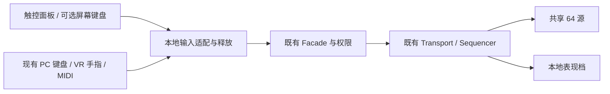

# 移动端适配调研与实施规划

调研日期：2026-11-04。范围：VRChat World 的 Android 手机 / 平板、Quest 独立运行及 iOS；不是独立手机 App 移植。本报告仅作静态分析和方案建议，尚未实施、构建或进行客户端验收。

## 1. 结论与建议顺序

现有数据 → Facade → Transport / Sequencer → 共享声音池 → 本地表现的架构可以继续使用。适配重点是**音频资源与实际声道能力、触控操作、手机挂起恢复、表现成本及跨平台内容一致性**。不能只切换 Unity Build Target 后宣称支持移动端。

建议分两层交付：先让手机能够可靠加入、听歌、选曲和控制播放，再完成触屏演奏及独立练习。Quest 与手机共享 Android 构建，但保留 VR 手指输入；iOS 单独构建和验收。既定共享 **64 个物理 AudioSource** 的规格继续保留，不以本报告恢复旧移动端 24 声部方案。

有两个应先验证的可行性问题：

1. 当前音源以 PCM / Decompress On Load 为主，移动端下载和内存压力明显；需要找到兼顾 64 源调度、起音、定位和弦乐循环的导入配置。
2. 本地 SDK 对 Android / iOS 的项目默认值为 24 个真实声道 / 32 个虚拟声道，项目工具则会回写为 64 / 64。**这两个 Editor 设置都不是客户端可用声道的证明**。如果真实客户端不能满足现行规格，应把结果交给维护者决定下一步，不能悄悄删音、排队延迟起音或减少声部来“通过”。

## 2. 证据范围与基线

| 项目 | 本次确认的事实 | 边界 |
| --- | --- | --- |
| 工作目录 | `C:/Users/<user>\ALCOM\Projects\musicMidiPlayer` | 当前目录 Git 无有效 HEAD，工程文件均为未跟踪状态；不能把文档中的私仓 `21c0593` 当作此次 checkout 提交 |
| Unity / SDK | `ProjectVersion.txt`：2022.3.22f1；`vpm-manifest.json`：Worlds / Base 3.10.5 | 核对了本地 SDK 源码；没有升级环境或核对所有新版本差异 |
| 场景 | `Assets/Scenes/VRCDefaultWorldScene.unity` 的磁盘保存内容 | 未连接 / 启动 Unity，没有读取未保存场景、当前平台或 backing Udon 内存 |
| 分发 | 两份独立钢琴 Prefab，练习为独立场景 | 主场景结论不自动等于它们均已适配 |
| 外部依据 | VRChat 官方 Creator Docs、官方 SDK 本地源码、Unity 2022.3 官方文档 | 访问日期见文首；网页可能包含较旧说明，API 是否存在另与 3.10.5 本地源码交叉核对 |

本次没有运行 Play Mode、ClientSim、Unity 测试、平台切换、Build & Test、上传或发布。性能、音频输出能力与可用性均未实测。

## 3. 官方实现有哪些可以直接借鉴

### 3.1 世界内面板：先利用 Focus View

官方 `VRC_UIShape` 的 **Allow Focus View** 允许手机 / 平板用户放大、平移和缩放世界内 UI。它还受世界网页设置、用户设置、距离及用户输入设备条件影响，不能仅凭组件开关断言可用。[官方 VRC Ui Shape / Focus View](https://creators.vrchat.com/worlds/components/vrc_uishape/#focus-view)

当前主场景的 `UI` 对象和 `UdonMidiPlayer.prefab` 已序列化 `AllowFocusView: 1`。因此第一步是核验 Focus View 的进入、退出、列表拖动、进度拖动与搜索，而不是把“缺少这个开关”列为缺陷。立式 Prefab 和独立练习场景仍须分别检查。

### 3.2 随身控制：参考官方 Screen Canvas 示例

官方 **Screen Canvas** 示例展示了非 VR 屏幕 UI、VR 隐藏处理和 `VRCButtonLayout`；后者用来预览手机原生按钮占位，并标为 `EditorOnly`。可从 `VRChat SDK > Example Central` 导入。其 ClientSim collider 行为有已记录差异，必须与真实客户端区分。[官方 Screen Canvas 示例与导入入口](https://creators.vrchat.com/worlds/examples/screen-canvas/)

建议只借用 Canvas 配置和避让原生控件的方法，面板命令继续调用本工程 Facade。示例的 Teleport 功能与本任务无关；本次未导入示例，也未假定示例已经存在于工程。新增快捷面板属于第二步，现有世界内 UI 继续作为完整控制入口。

### 3.3 输入识别和横竖屏：使用已有 Udon 事件

官方建议通过 `OnInputMethodChanged` 与 `InputManager.GetLastUsedInputMethod()` 识别触控；输入类型会随键盘、手柄等使用而变化，不能用 Android 且非 VR 代替触控识别。[官方 Input Events](https://creators.vrchat.com/worlds/udon/input-events/#oninputmethodchanged)

`OnScreenUpdate` 提供方向及分辨率，在移动端进入世界和方向变化时触发；它没有文档化的安全区字段，也不是任意窗口尺寸变化的通用通知。[官方 OnScreenUpdate](https://creators.vrchat.com/worlds/udon/graph/event-nodes/#onscreenupdate)

本地 3.10.5 的 `Packages/com.vrchat.worlds/Integrations/UdonSharp/Runtime/UdonSharpBehaviour.cs` 已声明下列签名，可作为实现入口；此处仅核对签名，没有编译新代码：

```csharp
public override void OnInputMethodChanged(VRC.SDKBase.VRCInputMethod inputMethod)
public override void OnScreenUpdate(VRC.SDK3.Platform.ScreenUpdateData data)
```

官方移动端指南还建议缩短文案、放大按钮并避免依赖 VR 专属手势。[Mobile Best Practices](https://creators.vrchat.com/platforms/android/android-best-practices/)

### 3.4 官方 MIDI 示例的用途边界

官方 `VRCMidiPlayer` 是配合 AudioClip 使用 MIDI 数据的示例入口，并没有给出本项目所需的多采样乐器合成、64 源分配、踏板 / 弦乐恢复与当前网络协议的替代实现。[官方 MIDI Playback](https://creators.vrchat.com/worlds/udon/midi/midi-playback/)

外接设备方面，官方实时 MIDI 文档提供 `VRCMidiListener` 和设备选择流程，但没有在该页保证 Android / iOS 的 USB / 蓝牙 MIDI 支持。当前 SDK 的 `Runtime/VRCSDK/SDK3/Midi/VRCPortMidi.cs` 实现又受 Windows 条件编译保护。这只能证明本地这条驱动路径的边界，不能据此宣称所有移动客户端永远不支持 MIDI。[官方 Realtime MIDI](https://creators.vrchat.com/worlds/udon/midi/realtime-midi/)

因此：内置 MIDI 文件播放、手机接收其他玩家演奏和手机直接连接硬件 MIDI 是三项不同能力。前两项进入适配计划；第三项标为待核验，不作为首阶段依赖，不向 Udon 工程加未经支持的原生插件。

## 4. 当前工程静态盘点

### 4.1 输入、UI 与座位

| 位置 | 现状证据 | 需要调整 / 验证 |
| --- | --- | --- |
| `Runtime/Logic/MidiPerformanceInput.cs` | `PostLateUpdate` 仅以 `IsUserInVR()` 分流；非 VR 入座后 `ReadDesktop()` 读取 A/W/S 等、Z/X、空格和 Enter | 增加触控与手柄等输入状态；手机不能继续只显示 PC 键盘说明 |
| `Runtime/Logic/MidiPerformanceSeat.cs` | 非 VR 设置 `station.disableStationExit = true`；快捷离座由输入类读 Enter；再次触发座位 `Interact()` 也会离座 | P0 核验入座后手机能否再次交互，并提供一直可达的“离开座位”；停止、加载、锁定、面板关闭等情况下均可用；不把静态风险写成已证实无法离座 |
| `Editor/Prefab/MidiPlayerUIBuilder.cs` | 主 Canvas 固定 `1000 × 480`，World Space，添加 `VRCUiShape` / GraphicRaycaster；若干按钮仅 34～38 UI 单位高 | 先在 Focus View 看可读性、命中区、遮挡和层级；屏幕 UI 再做锚点与比例布局，不直接把世界坐标尺寸当手机像素 |
| `Runtime/UI/MidiPlayerUI.cs` | `Start` 将 Selectable Navigation 置 None、ScrollRect scrollSensitivity 置 0；自定义 `Update` 仅处理 VR 摇杆 / 鼠标滚轮 | 保留防移动误操作设计；原生 ScrollRect 有拖动路径，不能据此断言触屏列表完全不能滚动；必须测拖动、惯性、点选冲突及 PointerEnter / Exit |
| 同上及 UI Builder | 已有搜索、目录返回、进度 PointerDown / PointerUp / EndDrag；Builder 给滚动空白区留有 raycast 图片 | 校验手机键盘开闭、中文输入、搜索耗时、拖动松手提交和取消；不把单击 / 拖动重复变成切歌或重复 Seek |
| 本地化 | `Localization/World` 已有 en、ja、zh-Hans、zh-Hant | 复用既有语言表；新增触控、离座和轻量表现文案同步四语 |

### 4.2 音源：主要风险是导入产物与常驻内存

本次将主场景文本中出现的 GUID 与 `Assets/UdonMidiPlayer/Audio` 的音频 `.meta` 对照；同一 GUID 只计一次。下表是**主场景直接序列化引用**的磁盘资产统计，未递归解析 Prefab / 其他资产依赖，也不判断对象是否激活。它是已发现集合，不是 Unity 完整依赖报告或实机内存。

| 集合 | 唯一音频文件数 | 源文件 MiB | 按源帧数 × 声道 × 4 字节估算的 Float32 MiB |
| --- | ---: | ---: | ---: |
| SelectedQ4 钢琴 | 120 | 20.45 | 607.73 |
| SelectedQ4 马林巴 | 61 | 1.14 | 42.32 |
| 弦乐五组，合并 | 314 | 44.16 | 88.29 |
| Virtuosity 鼓组 | 232 | 10.08 | 305.32 |
| 合计 | **727** | **75.82** | **1043.66** |

统计方法：WAV 读取 RIFF fmt / data，Ogg Vorbis 读取声道与末页 granule position，按完整源长度估算；全部 727 份 `.meta` 的默认 loadType / compressionFormat 为 0 / 0（Decompress On Load / PCM），平台覆盖为空。未直接引用的旧采样没有计入此表，也没有删除。不是此前源码快照的“757 个采样”口径。

Float32 数字用于比较源数据规模，**不等于 Unity 的解码格式、实际常驻分配或下载包体**。作为另一证据，既有钢琴 `IMPORT-REPORT.json` 记录 `observedEditorClipMemoryBytes = 319083864`，约 **304.30 MiB**；它是历史 Editor 记录，本次没有重测。马林巴历史报告的样本长度估算与本次源文件头统计略有不同，亦不能当作最新实测。

`SelectedToneBankImporter.cs` 明确设为 PCM、预解码、预载入，并清除 Standalone / Android 覆盖；`MidiPercussionBuilder.cs` 会清除 Standalone / Android / iOS 覆盖。仅手动设置 Android 音频覆盖，后续重导入就可能被覆盖；前者也没有对 iOS 做对称处理。

Unity 将 Decompress On Load、Compressed In Memory 和 Streaming 定义为不同的内存 / 解码成本取舍，Streaming 也有逐 clip 缓冲成本，不能把几百个短采样一律改为 Streaming。[Unity 2022.3 Audio Clip](https://docs.unity3d.com/2022.3/Documentation/Manual/class-AudioClip.html)

建议先比较下列**实验候选**，不在本报告批准任何音质降级：

| 候选 | 要解决的问题 | 主要验证点 |
| --- | --- | --- |
| 平台压缩 + Decompress On Load | 减少构建音频字节，尽量保留当前播放成本 | 仍可能大量占内存；不能把压缩包变小写成内存下降 |
| 长采样 Compressed In Memory，短起音保留预解码 | 减少常驻音频内存 | 多源并发 DSP CPU、首次起音、变调、`timeSamples` 恢复和音质 |
| 弦乐 attack / loop 分别评估 | 控制循环常驻成本，保留双源衔接 | loop 边界、暂停 / Seek / 晚加入的循环位置、延音尾部 |

现有 48 kHz 立体声四层钢琴与完整根音马林巴规格仍有效；不自动改为单声道、降采样、砍力度层或换稀疏 bank。若实验仍不能满足资源限制，必须形成明确的规格取舍提案。压缩源 Ogg 已有损，二次转码也应听音比较。

烘焙链有额外依赖：`AudioEnergyBaker.cs` 用 `AudioClip.GetData` 读取 20 ms 能量包络，失败时明确要求 Decompress On Load。应在可读取的作者端配置完成烘焙，再验证移动端使用已烘焙数据；不能直接全局改加载类型而破坏能量、峰值与哈希检查。

### 4.3 64 源预算与 SDK 默认值冲突

| 证据 | 当前值 / 行为 | 能证明什么 |
| --- | --- | --- |
| 保存主场景 | 64 个 AudioSource 组件 | 本地物理池容量；不证明客户端每源均有声 |
| `ProjectSettings/AudioManager.asset` | 真实 / 虚拟 64 / 64，48 kHz | 保存的项目设置 |
| `MidiPlayerAudioSettings.ApplyNow()` | 项目显式启用后，Editor 更新 / 构建前将配置恢复 64 / 64，并调用 Editor 的 `AudioSettings.Reset` | Editor 配置修复；不控制宿主 VRChat 客户端的全局音频配置 |
| SDK `EnvConfig.SetAudioSettings()` | Android / iOS：真实 24、虚拟 32；其他平台：真实 32、虚拟 64 | 3.10.5 官方 SDK 的项目默认写入逻辑；不是本报告测得的客户端硬上限 |

官方优化文档只说明 Android 世界的 AudioSource 受到限制，没有在该节给出可用于保证 64 源输出的数字。[官方 Audio Sources 说明](https://creators.vrchat.com/platforms/android/quest-content-optimization/#audio-sources)

首个真机可行性实验需要区分：逻辑音数、物理源占用、已预约源、真实 / 虚拟声道、弦乐 attack + loop 双源，以及与玩家语音和世界环境声的竞争。测试稠密钢琴踏板、弦乐合奏、鼓组混合与 2D / 3D 切换，记录实际缺音和声音池诊断。沿用弦乐与鼓组现有物理源分配规则，不把 64 源解释为每件乐器 64 音。

### 4.4 表现、场景与加载

以下均为保存场景的序列化数量 / proxy 字段，含不激活对象；不是当前可见数量、draw calls、活跃粒子或 backing Udon 实际值。

| 项目 | 静态盘点 | 建议 |
| --- | --- | --- |
| 钢琴 / 马林巴瀑布 | 3 组，每组 512 条，窗口 3000 ms | 先比较移动端每组 128 / 256 条候选，仅约束可视池；保留完整音频事件 |
| 命中特效 | 每组 totalParticleBudget 768、每帧 64、maxHitsPerFrame 24 | 引入本地表现档；减少透明覆盖与音符 / 符号 / 光环叠加，预算需覆盖同时启用的多组效果 |
| 命中灯 | 三组 maxActiveLights 已为 0 | 不把“关闭命中灯”写成尚未完成的主要收益 |
| 整个保存场景 | MeshRenderer 2493、Light 25、ParticleSystem 144 | 后续通过 Editor / 构建依赖区分激活、烘焙 / 实时、材质与可见三角面；不能将数量直接相加换算帧率 |
| 主 UI | songButtons 547 个引用 | 作者完整曲库口径；搜索 / 目录会遍历和切换行对象。先测输入与布局尖峰，再决定分页 / 复用可见行，不动 songId 与全库搜索语义 |
| 加载 | Facade 的 decodeFrameBudgetMs 保存为 5；解码、路由、鼓扫描及绑定已有共享耗时预算 | 测移动端 p95 / p99 帧时间；候选 1～2 ms 预算只用于加载阶段，不能借机恢复正常播放的旧事件截断 |

`WaterfallVolume.shader` 已为不透明、单 Pass，包含实例属性和 GPU 时间驱动；`MidiWaterfallView` 已复用 PropertyBlock。不要再以“全面把瀑布改成不透明 / 移到 GPU”为未做工作。优先检查 GLES3 / Metal 编译、GPU 顶点变形后的 bounds / 裁切、实例合批是否实际发生；GPU 动画也不等于零 CPU / 零 draw call。

`WaterfallSoftSpark`、`WaterfallImpactGlow`、`WaterfallMusicSymbol` 及 `UIBackplate` 有透明 / 加法混合；`StringVibration` 使用 Standard surface 路径。可评估简化材质与片元计算，但要保留发声反馈及既定美术。**世界允许自定义 Shader，Avatar 的 Shader 白名单不能套用到本项目。** [官方 Worlds Shader 说明](https://creators.vrchat.com/platforms/android/quest-content-optimization/#shaders)

世界几何、纹理、灯光图和字体图集必须进入完整预算；优先复用共享资源、减少多余材质、使用平台纹理压缩、烘焙环境照明。UI 字体应保留 CJK 可读性，不能为压纹理尺寸直接缺字。是否需要进一步合并模型、裁减教室装饰，应等可见性和整包数据后再决定。

## 5. 拟实施方案与受影响位置

### 5.1 三条独立的适配轴

不要让一个 `isMobile` 同时决定全部行为：

- **构建平台**决定导入格式、Shader 编译目标及包体；Android / iOS 独立产物。
- **VR 显示模式**决定是否保留现有 VR 手指和空间操作路径。
- **最近输入方式**决定提示、触控控件及键盘 / 手柄切换；只影响本地，不进入网络权威状态。



### 5.2 手机控制面板

先以现有 World Space + Focus View 完成主功能。只有仍存在远距离操作或尺寸问题时，再增加可收起的 Screen Canvas 快捷入口，显示曲名、播放 / 暂停、曲库入口、本地音量与离座。横屏可并排曲库 / 播放区，竖屏以分页为主；新增点击区建议从约 48 个参考布局单位试起，这是设计候选，不是 VRChat 官方强制像素标准。

`OnScreenUpdate` 只做布局切换，避让原生摇杆、菜单、刘海 / 挖孔和系统手势区；安全区可用 API 及实际覆盖范围需核验，不能假造 `ScreenUpdateData.safeArea`。搜索框聚焦时暂停本工程键盘音符读取，关闭 / 旋转时取消未提交拖动。选择歌曲、播放和共享设置继续走既有 Facade / gate；音量、静音、语言和表现档只影响本地。

### 5.3 触屏演奏与练习

首阶段要保证手机入座后始终有可达的退出路径，不能依赖 Enter 或假定座位 Collider 一定能再次点到。第二阶段增加可收起的 1～2 个八度键盘 / 适合鼓组的打击垫、八度切换和明确的踏板开关，复用 `PerformInstrumentNoteOn`、`PerformNoteOff`、`PerformControlChange` 及现有通道映射。切乐器 / 输入方式 / 离座 / 禁用 / 旋转 / 打开阻断面板时释放本输入持有的音符及踏板。

**多点触控是先验证的交互能力，不是本报告保证。** 当前 Button / EventTrigger → SendCustomEvent 链没有现成的多 pointer 状态。先在目标 SDK 与客户端核验 Udon 暴露的触点数据、UI 路由、拖出键面和取消事件；验证成功再做按触点记录的和弦 / 滑奏。普通 `onClick` 不能代表带按下 / 松开生命周期的钢琴键；也不能承诺屏幕键盘与原生移动摇杆同时操作一定正常。

练习系统继续独立在 `Samples/MidiPractice.unity` 接入；设备与音频路径的实测延迟可以影响评分窗口 / 校准方案，但不能未经测量全局加大判定窗口。硬件 MIDI 映射在触控模式可收为高级入口，说明实际可用能力，不能把手机上的 PC MIDI 设备提示作为必要步骤。

### 5.4 挂起、恢复与公共状态

源码有 Owner 心跳、失活接管和离线处理，但当前 Runtime 没有 `OnPlayerSuspendChanged` 处理。官方说明手机切后台 / 休眠后不运行 Udon，也不处理网络事件；本机的该事件在唤醒时触发，远端才能观察它的挂起。[官方 OnPlayerSuspendChanged](https://creators.vrchat.com/worlds/udon/graph/event-nodes/#onplayersuspendchanged)

因此不能依赖本机挂起时一定发送 NoteOff。建议：

1. 本地唤醒清理触控持音、踏板和过期预约，按现有 generation 重建当前时刻，不重放整个后台时段的逐音队列。
2. 活跃客户端观察挂起演奏者 / Owner，按现有 Owner、epoch、revision 与权限边界失效实时输入或接管公共维护；避免多端同时抢占，也避免等待永不运行的挂起端释放。
3. 恢复后重新获取当前快照，防止旧本地状态覆盖新 Owner 的播放；独立练习只恢复个人状态。

普通客户端低帧率追赶和“休眠后按快照恢复”是不同路径；保持已取消的 100 ms / 256 事件 / 80 ms 起音等旧门控不回归。具体挂起恢复方案应同时覆盖 PC / Quest 等设备可能挂起的情况，不只硬编码手机。

### 5.5 跨平台身份和发布

各平台继续使用同一世界 Blueprint ID，避免误生成无法互通的新世界；官方对 Android 内容在 iOS 的 fallback 有说明，但它不能替代本项目的 iOS 构建和实机验收。[官方 Cross-Platform Setup](https://creators.vrchat.com/platforms/android/cross-platform-setup/)

`MidiContentHash.Bank` 已对源文件、GUID 和整份 `.meta` 求哈希，`Catalog` 又包含 bankHash；NetworkTransport 会拒绝不相等的 catalogHash。平台切换本身不应制造新身份，但**新增导入覆盖会改变 `.meta` 和 bankHash**。

应让 Windows / Android / iOS 使用同一份声明了平台覆盖的源资产与烘焙逻辑数据；最终 `.meta` 确定后统一重烘焙，再依次构建。核验歌曲 ID、曲库顺序、规则、音色目标和 catalogHash 相同；不能通过关闭哈希校验、删手机曲目或自动同步场景曲库到分发 Prefab 来绕过。导入器必须保留所声明的覆盖，不能平台切换时反复改写配置。

以同一主场景增量适配，不新建替代主场景，不 Apply 实例覆盖。两份分发 Prefab 和独立练习在其自己的里程碑中分别适配，不顺带覆盖曲库。

### 5.6 变更位置清单

下列都是后续拟修改位置，不表示本次已创建类或改变行为。

| 范围 | 主要文件 | 拟变更 |
| --- | --- | --- |
| 输入 / 离座 | `Runtime/Logic/MidiPerformanceInput.cs`、`MidiPerformanceSeat.cs`、`Editor/Prefab/MidiPerformanceBuilder.cs` | 输入方式分流、触屏入口、确定的退出与释放生命周期 |
| UI / 语言 | `Runtime/UI/MidiPlayerUI.cs`、`Editor/Prefab/MidiPlayerUIBuilder.cs`、`MidiHardwareMappingUIBuilder.cs`、`Localization/World/*.json` | Focus View 操作验证后的小幅调整，必要时手机快捷布局、搜索与提示 |
| 音频导入 / 烘焙 | `SelectedToneBankImporter.cs`、`MidiStringsBuilder.cs`、`MidiPercussionBuilder.cs`、`MidiContentHash.cs`、`AudioEnergyBaker.cs` | 声明式平台覆盖、保留烘焙可读性、统一哈希；仅在确有需要时调整烘焙逻辑 |
| 音频配置 | `MidiPlayerAudioSettings.cs`、`PianoVoicePool.cs`、`MidiEnsembleVoicePool.cs`、`StringsVoicePool.cs`、`PercussionVoicePool.cs` | 先核验 SDK 回写与客户端输出，再按证据处理；不自动减为 24 源 |
| 表现 | `Runtime/Views/*`、`Shaders/*`、相应 Presentation Builder | 本地档位、预算 / 材质候选、跨 GPU 兼容与裁切 |
| 加载 / 挂起 | `MidiPlayerFacade.cs`、`MidiNetworkTransport.cs`、`MidiSequencer.cs` | 沿用分帧加载，挂起恢复 / 失效实时输入与既有接管衔接 |
| 接线 / 分发 | 主场景、两份 Prefab、独立练习、`MidiBuildValidator.cs` | 分阶段更新 proxy / backing 与引用；平台检查优先独立报告，不恢复日常构建的硬阻断 |

表内未带目录的 Editor 文件在 `Assets/UdonMidiPlayer/Editor/Prefab/` 或 `Editor/Baking/`，Runtime 文件在对应模块；沿用 `MusicMidiPlayer.*` 和 Runtime / Editor 隔离。

## 6. 分阶段执行与完成条件

| 阶段 | 具体产物 | 完成条件 / 依赖 |
| --- | --- | --- |
| A：可行性取证，P0 | 当前场景完整依赖和 Android 构建大小、音频导入候选对比、真实声道与内存记录 | 先知道能否守住 64 源规格及移动端资源约束；未通过则提交具体差距与取舍，不开始大规模改 UI |
| B：基础使用，P0 | 触控识别、可达离座、可用曲库 / 进度 / 搜索、必要的本地轻量表现、挂起恢复 | Android 手机与 Quest 均能完成听歌 / 选曲 / 控制；PC 回归及跨端 Owner / 晚加入通过 |
| C：演奏与练习，P1 | 触屏键盘 / 打击垫可行性及实现，踏板 / 八度控制，独立练习接线 | 输入取消不粘音；如要宣称多指演奏，须有多触点实机证据；练习延迟有记录 |
| D：iOS 与分发收口 | iOS 独立产物、跨端一致性记录，两份 Prefab 与练习各自结果、安装文档 | iOS 实机验收；分发不改宿主全局设置，曲库与 GUID 保留；各产物分别声明能力 |

建议首轮实际实施从 A + 离座问题开始。Screen Canvas、列表虚拟化与采样加载改造都根据结果决定，不预先做全套重构。阶段可以分别交付，但完成 B 不应将 C 写成“移动端全部适配完成”。

## 7. 验证计划与预算口径

本节是后续实施时的计划，不是本次运行记录或额外强制构建流程。

官方当前列出的 Android 世界构建压缩后限制为 **100 MB**；完整世界需要为场景、音频、字体等共同留空间。源文件总和无法证明是否满足该限制。[官方 File Size](https://creators.vrchat.com/platforms/android/quest-content-optimization/#file-size) iOS 官方说明其内容限制与 Android 共用。[官方 iOS 设置](https://creators.vrchat.com/platforms/iOS/setting-up-unity-for-creating-ios-content/)

| 设备 / 场景 | 覆盖内容 | 记录指标 |
| --- | --- | --- |
| Android 手机，横 / 竖屏 | Focus View、列表滚动与搜索、软键盘、进度拖动、离座；触屏 / 手柄切换 | 点击误触、布局遮挡、搜索响应、首次起音与实际操作录像 |
| Quest 独立运行 | VR 手指路径、空间 UI、双眼 Shader、相同曲目 | CPU / GPU 帧时间、可见音符、语音竞争、音频缺音 / 爆音 |
| iPhone / iPad | ScreenUpdate、Metal 材质、音频、软键盘与系统切后台 | 与 Android 分开记录，不复用其“通过” |
| PC + 移动端同实例 | 切歌、Seek、暂停恢复、晚加入、Owner 离开 / 休眠、实时演奏发送和接收 | catalogHash、状态一致性、恢复误差、旧 revision 是否被拒绝、卡音清理 |
| 密集 / 长曲压力 | 四层钢琴踏板、弦乐循环与鼓组叠加、连续换曲、547 首作者曲库搜索 | 加载 p95 / p99、帧尖峰、进程 / 音频 / 纹理内存、GC、热降频和至少一段持续播放 |
| 两份 Prefab / 练习 | 干净宿主导入、各自内容和接线 | 不改宿主全局 AudioManager，不擅自换曲库；独立列验证结论 |

音频方案比较必须使用相同歌曲、设置和场景；分别列源编码字节、构建后下载字节、解码数据估算、实机常驻 / 峰值内存、DSP CPU 和起音 / 恢复表现。设备型号、系统 / 客户端版本、画质、人数及测试时长要随结果保存。测不到的指标记 `not_measured`，不可由 Editor 推导成手机结果。

帧率和温升目标需绑定实际目标设备。可以先以手机 30 FPS 持续运行作为试验候选（帧预算约 33.3 ms），Quest 按测试设备的实际刷新率评价；这些是建议验收起点，不是官方统一保证，也不是对用户既有预算的修改。

Android 的官方 Build & Test 使用 ADB 将世界资产传入已安装的 VRChat；iOS 使用 iOS Build Support 与局域网 VTP，按文档连接 SDK 和设备。这里构建的是 VRChat 内容，不是自行打包发行完整 Android / iOS App；不应把制作独立 iOS App 所需的流程机械加给本项目。[Android Build & Test](https://creators.vrchat.com/platforms/android/build-test-mobile/)、[iOS Build & Test](https://creators.vrchat.com/platforms/iOS/build-test-mobile/)

## 8. 本次交付与仍未确认的事项

本次完成：读取现行工程约束；核对 Runtime / Editor 调用链、保存场景、音频 `.meta`、本地官方 SDK 事件与音频默认配置；进行上述静态资源盘点；查阅官方实现及构建文档；建立适配阶段和验证清单。

仍未确认：移动端真实可用声道 / 预约行为、完整构建依赖及包体、实机内存与帧率、Focus View 在该世界和用户设置下是否可用、触屏多指路由、硬件 MIDI 移动端能力、iOS / Android 模块与测试设备是否就绪、未保存场景与磁盘差异。

只有这份报告与文档导航发生变化。运行代码、采样、导入设置、GUID、场景、Prefab 和曲库均未修改。
