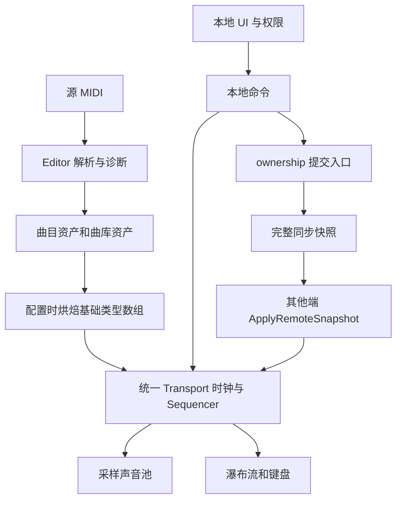

# passhuPiano 文档索引

## 当前阅读入口

| 读者 / 任务 | 先读 | 状态 |
| --- | --- | --- |
| 安装与使用 | [快速开始](../GETTING_STARTED.md) | 当前入口，不表示验收通过 |
| AI / 程序修改 | [AI 工作指南](../Developer/AI_GUIDE.md)、[当前实现](../Developer/CURRENT_STATE.md) | 明确源码基线与证据边界 |
| 提交乐器 | [贡献政策](../Contributing/README.md)、[预算](../Contributing/BUDGETS.md)、[模板](../Contributing/INSTRUMENT_SUBMISSION_TEMPLATE.md) | 2026-11-02 维护者已确认 |
| 工具检索 | [文档地图](../doc-map.json)、[政策 JSON](../Contributing/instrument-policy.json) | 机器可读；未测值用 null |

下面技术分册包含当前规则、分日期更新及历史设计。旧段落中的“当前”仅指其记录日期；v0.1 的初始范围、单层音源或“尚未实现”不能覆盖新入口、维护者确认政策和实际源码。细粒度修改时再按任务读取相应分册。

## 技术分册与历史说明

面向 VRChat World 的钢琴 MIDI 播放器：开发者批量导入 MIDI、配置曲库并拖入 Prefab，即可获得多人共享播放和实时 88 键瀑布流。

设计基线日期：2026-10-23；本索引更新：2026-10-24。适用基线：Unity 2022.3.22f1、VRChat Worlds SDK 3.10.5 及其内置 UdonSharp。Editor 工具、Runtime 脚本、源音色、主 Prefab 与示例资源已经落盘。AudioClip 区域映射问题已修复，当前模型/音源的原生按钮到实际 Udon 的 Editor 检查通过；真实 VRChat 双客户端与听音验收尚未执行。

各分册保留最初工程设计与验收计划，其中“待实现”及初始音源参数不等于当前代码状态。当前接入方式、模型和音源说明优先阅读[随资源说明](../../Assets/UdonMidiPlayer/README.md)，具体实现以 `Assets/UdonMidiPlayer` 源码及烘焙资产为准。

2026-10-31 文档起草补充：新增 [新乐器追加规范（待审阅）](18-adding-instruments.md) 与 [GM Program 0～127 fallback 路径（待审阅）](19-gm-program-fallback.md)。第 18 册汇总源码、音源清单和已保存场景的静态状态及追加检查位置；第 19 册为拟定映射，并注明 Program / Bank 保存链的并行更新状态，本文 fallback 表尚未写入音频路由。两份草案未修改运行代码、音源、Prefab 或场景，也不代表运行验收通过；旧资源说明和准备文档的历史状态不能直接用作当前能力清单。

2026-11-01 实现补充：主场景已接入乐器复选框、分组＋例外的 GM 自动路由及共享 64 源多音色播放，完整规则与维护入口见[第 19 册](19-gm-program-fallback.md)。此前“fallback 尚未写入路由”的说明保留为历史快照；当前验证范围以对应报告为准，未进行真实 VRChat 双客户端验收。

2026-11-02 Windows 性能优化：已在源码中收敛重复表现刷新、按状态更新歌曲／乐器 UI、合并合奏音频输出结算、迁移瀑布运动至支持实例属性的 Shader，并将加载收尾纳入分帧流程。实现边界及未验收项见[第 09 册](09-performance-and-validation.md)；本轮按要求未运行测试或构建，不代表已取得实测性能收益。

## 1. 阅读顺序

2026-11-02 源码发布跟进：`1.0.0-rc.2` 对应本次性能 / UI / 场景更新，目标 GitHub 私仓 `passworked/passhuPiano`；继续过滤曲谱、音源及派生数据，具体进度见[第 22 册](22-release-implementation.md)。rc.1 保持封存；不将本次上传视为稳定版或实测性能验收。

2026-11-01 发布实施：用户已确定自有美术 CC BY 4.0、署名 passhu，并要求排除更严格或未知授权的谱子与音源。当前本地实施入口、白名单、候选工具和未验收项见[第 22 册](22-release-implementation.md)，此前“仅规划”的记录为历史阶段。

2026-11-01 发布规划：新增 [v1.0 预制体发布与 monorepo 开源](21-v1-release-and-open-source.md)。采用自有代码 MIT、自有美术拟用 CC BY 4.0、第三方保留原许可；明确两份独立钢琴 Prefab 的首发范围、完整项目同仓组织、授权清单、导出收口及 RC 放行条件。当前仅为规划，未执行 Git 初始化、资源迁移、导出或公开发布。

| 文件 | 内容 | 主要读者 |
| --- | --- | --- |
| [CONTRACTS](CONTRACTS.md) | 公共字段、时间单位、状态、模块接口与默认参数 | 所有实现者，先读 |
| [01 架构与权威边界](01-architecture.md) | 从 Editor 数据到逻辑、网络、音频、表现的完整依赖 | 项目负责人、程序 |
| [02 数据与 MIDI 导入](02-data-and-import.md) | 格式支持、tempo、配对、踏板、扁平数据及恢复索引 | 工具与逻辑程序 |
| [03 播放与音符逻辑](03-transport-and-sequencer.md) | Transport 状态机、统一时钟、事件调度、暂停恢复 | 逻辑程序 |
| [04 多人同步](04-multiplayer-sync.md) | 可转移 Owner、快照、晚加入、校准、失活接管 | 网络与逻辑程序 |
| [05 钢琴音频](05-piano-audio.md) | 采样音源、复音、DSP 预约、包络和声音恢复 | 音频与逻辑程序 |
| [06 瀑布流与钢琴表现](06-waterfall-and-keyboard.md) | 88 键布局、音符几何、窗口池化与高亮 | 表现程序、美术 |
| [07 控制与 UI](07-controls-and-ui.md) | 用户操作、曲目列表、本地设置、权限及文案 | UI 与交互程序 |
| [08 编辑器与 Prefab](08-editor-and-prefab.md) | 导入配置、烘焙、接线、构建检查和目录结构 | 工具程序、世界作者 |
| [09 性能与验收](09-performance-and-validation.md) | 性能预算、测试曲、多人场景与记录口径 | 程序、测试 |
| [10 里程碑与交付](10-milestones-and-delivery.md) | 依赖顺序、任务清单、关卡与最终交付 | 项目负责人 |
| [11 参考与技术依据](11-reference-notes.md) | VVMW 源码事实、官方来源、本工程证据与验证边界 | 评审、后续维护 |
| [12 命名空间与分发](12-namespaces-and-distribution.md) | MusicMidiPlayer 完整类型名、程序集、资源标识与升级规则 | 所有实现者、分发维护者 |
| [13 主场景乐器切换](13-instruments.md) | 两种钢琴外观、马林巴、统一输入、音色修改与预算 | 世界作者、音频与维护者 |
| [14 通用 MIDI 鼓组](14-percussion-preparation.md) | Virtuosity 采样、主场景接线、one-shot/choke、鼓件模型与表现 | 世界作者、音频、表现与维护者 |
| [14 弦乐组接入准备](14-strings-preparation.md) | VSCO 音源、代表采样、无人乐器运弓表现与接入缺口 | 音频、美术与程序 |
| [15 UI 层级与绘制顺序](15-ui-hierarchy.md) | 当前 Canvas 层级、弹层遮挡、射线规则、生成与维护入口 | UI 与工具程序 |
| [16 项目约定恢复依据](16-project-conventions-recovery.md) | AGENTS.md 重建来源、会话定案及废弃方案 | 所有维护者 |
| [17 项目维护约定](17-maintenance-conventions.md) | 开发方式、场景与分发、曲库、音源、表现和验证细节 | 所有维护者 |
| [18 新乐器追加规范（草案）](18-adding-instruments.md) | 现有乐器与接线状态、资源 / 调度要求、追加时的代码与文档更新矩阵 | 音频、工具、表现与维护者 |
| [19 GM 音色分组与回退](19-gm-program-fallback.md) | 复选集合、11 组模板与例外、128 项排序、同步及共享声源 | 音频、逻辑、数据与维护者 |
| [20 DEMO 日系音乐教室](20-demo-music-classroom.md) | Blender 源模型、主场景接入、美术碰撞与播放器保护边界 | 美术、世界作者与维护者 |
| [21 v1.0 发布与开源规划](21-v1-release-and-open-source.md) | 两份钢琴 Prefab、完整项目 monorepo、MIT / CC BY 范围、第三方许可、RC 与发布维护 | 项目负责人、分发与开源维护者 |
| [22 发布实施记录](22-release-implementation.md) | passhu 署名、曲谱 / 音源白名单、独立曲库筛选、包与源码工具、候选证据和剩余验收 | 分发与开源维护者 |

## 2. 历史设计：v0.1 首版范围

| 优先级 | 项目 | v0.1 交付边界 |
| --- | --- | --- |
| P0 | 批量导入 | Editor 批量处理 .mid，生成曲目资产并烘焙运行数据 |
| P0 | 钢琴播放 | 多区域采样、复音、力度、NoteOn/NoteOff、基础 CC64 延音 |
| P0 | 控制 | 播放、暂停、停止、切曲；切曲后保持停止，按播放起播 |
| P0 | 瀑布流 | A0～C8、立体晶体音符、同色高亮、命中粒子、局部环境光与烘焙反射 |
| P0 | 多人 | 操作者可取得播放器 Owner 并提交状态，各端本地跟随；支持晚加入和接管 |
| P0 | Prefab | 默认接线、可配置曲库、示例与说明，接入无需改代码 |
| P1 | 拖动与变速 | 预留内部重建和时钟边界，首版无进度拖动与变速控件 |
| P1 | 搜索、随机、歌单 | 后续扩展曲库层 |
| P1 | Quest 专项优化、外部事件 API | 首版按 PC 验证；内部方法不视为稳定外部 API |

P0 的格式边界是 SMF Type 0/1、PPQ、钢琴音域与已选择的旋律轨。首版不是通用 GM 多乐器合成器。东方曲库与猜曲游戏作为后续使用案例，基础播放器不包含专属规则。

## 3. 核心架构

每个客户端都持有同一曲库并本地计算音符；网络只交换播放状态。播放器 Owner 是可转移的公共状态写入者，与实例 Master、控制权限和本地表现计算分开。源数据与音源配置在 Editor 确定，运行中不传曲目文件、不逐音广播。

所有项目自有 C# 类型显式使用 `MusicMidiPlayer.*`，编辑器类型使用 `MusicMidiPlayer.Editor.*`；运行与 Editor 程序集分开。Prefab 分发同时保持 `.meta`、程序集名和完整类型名稳定，具体约定见第 12 册。

## 4. 历史资源与验证记录（2026-10-24 起）

当前默认配置使用 WhiteGrandPiano 白色三角钢琴 FBX，按 `Key_021_…`～`Key_108_…` 绑定独立琴键。Editor 从真实键的几何烘焙瀑布流横坐标与宽度，保留原材质及导入根变换；模型模式关闭原型键和实体背景墙，控制 UI 独立置侧。模型与音源可在 `MusicMidiPlayer.Editor.Assets.MidiPlayerConfigurationAsset` 中选择，运行侧不读取该 Editor 源资产。

选定音源为 Salamander Grand Piano 的单力度层 v9，30 个根音、48 kHz 立体声、无循环、Vorbis q8 源文件，合计 10,188,801 字节（9.72 MiB）。所有 MIDI 力度使用同一层并以增益响应，不宣称保留原始 16 层的音色动态。分区域 `tuningCents`、键区和 SF2 释放参数参与 bankHash；当前调音范围 −38～+13 cents，释放为 1000/4999 ms，最大释放尾垫为 4999 ms，不能套用分册中早期 180/300 ms 的初始值。原作者与 CC BY 3.0 署名、层选择和转码说明随资源分发。

9.72 MiB 仅表示压缩源音频总量。当前 Unity 使用 PCM + Decompress On Load，避免对已编码 Vorbis 再做一次有损编码；这不表示 Unity 构建产物沿用 Ogg 字节。导入报告的 float32 纯采样缓冲估算约 154.29 MiB，Editor 的 AudioClip 原生内存观测约 77.26 MiB，均不能代替 VRChat 客户端内存、最终世界下载或 `.unitypackage` 体积；报告还不包含全部对象、声音池和平台开销。

`MusicMidiPlayer.*` 命名空间、分离的 Runtime/Editor 程序集、Runtime U# 注册和逐脚本程序资产已接入工具。主 Prefab 增量配置时保留资产 GUID，显式设置网络 backing 为 Manual、其他本地 backing 为 None。`BuildPrefabOnly()` 可在保留未保存场景的前提下只更新主 Prefab；完整示例重建仍拒绝覆盖脏示例场景。构建校验和本地包导出工具已经实现，最终包仍需实际导出与复核。

当前主 Prefab 已加入后端铰链琴键动画（35/90 ms，白键约 8 mm、黑键约 6 mm）、每曲原始 MIDI SHA256 决定的单一主色调，以及 CC67/66/64 对应的左中右三踏板动画。白键统一使用浅亮色，黑键统一使用同色相的深饱和色；对应瀑布、粒子、光环及环境灯跟随黑白键两种颜色。本地静态环境粒子碰撞与 128 px 烘焙反射已接入。暂停按音乐时间冻结，停止及切歌复位。踏板时间线加入 schema 2，CC66/67 目前仅驱动表现，不扩展音频；源曲目已重导入并保留 GUID/songId。更新通过 `UpdateExistingPrefab()` 直接修改原 Prefab，默认场景原实例继承，未创建新场景。

开发期间已执行 29 项 Parser 边界检查、Unity C#/UdonSharp 编译，以及默认场景原实例的 Editor 原生 Button.onClick → backing Udon 检查。最新[Play Mode 报告](../../Logs/MusicMidiPlayer-playmode-report.json)覆盖播放、暂停、切歌、停止、实际声部 clip/pitch/generation 映射、琴键中间动画帧与恢复、瀑布同色和三踏板按下/平滑释放/复位；三踏板完整覆盖采用运行时临时控制数据，未改动源 MIDI。Prefab 的网络 Manual、本地 None 序列化设置也通过校验。该报告是开发工程记录，不随资源包分发。

这些检查不包含鼠标/VR 射线点按、捕获音频或听感验收。真实 VRChat 双客户端、晚加入、所有权竞争、失活接管和长时间偏差尚需按[性能与验收](09-performance-and-validation.md)执行。各分册性能数字继续按初始目标处理，不标成已经达到的指标。
